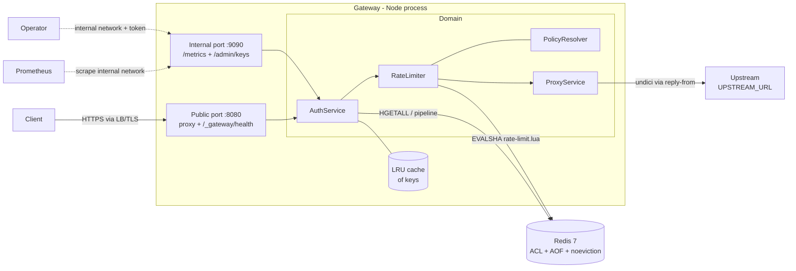

# RateLimitGateway — Implementation Plan

> Portuguese translation: [plan.pt-BR.md](plan.pt-BR.md). This English version is the
> project's source of truth.

> **Status:** Approved on 2026-11-22.
> **Version:** v2, an architecture and security review of v1 (summarized in section 0).
> Related documents: [threat model](threat-model.md) and [ADRs](decisions/README.md).

---

## 0. Changes from v1

v1 had sound rate-limiting logic, but the review found **four real security flaws** and
two architecture problems.

| # | Problem in v1 | Impact | Fix in v2 |
|---|---|---|---|
| R1 | **SSRF via the request-target.** For an *absolute-form* request (`GET http://evil.com/ HTTP/1.1`), Node's `req.url` contains the full URL. With path `//evil.com/x`, `new URL(path, base)` replaces the host. | The gateway can be used as an open proxy to any destination | Target URL built **only** from `UPSTREAM_URL` + validated path; absolute-form and `//` are rejected (section 6.4) |
| R2 | **Route-policy bypass via path normalization.** `/v1/x/../calculate`, `/v1//calculate`, `/V1/Calculate` or `%2e%2e` do not match the `/v1/calculate` prefix, but the upstream may normalize them to it | The per-route policy is bypassed | Strict path validation before matching, and case-insensitive matching (section 6.4) |
| R3 | **Auth and rate limit ran after reading the body.** Fastify's `preHandler` runs after body parsing | A client without a key makes the gateway buffer 1 MiB per request (DoS amplification) | Auth and rate limit in the `onRequest` hook, **before** the body is read (section 2.2) |
| R4 | **Broken key format.** A base64url `secret` contains `_` and `-`, so parsing by `_` fails | Functional bug and parsing ambiguity | Base62 `secret`, with a fixed-format regex (section 4.1) |
| R5 | **Admin routes on the public port,** protected only by a token | A leaked token gives full control from the internet | Admin and `/metrics` on an **internal port** that is not published; the token is still required (defense in depth) |
| R6 | **Brute-force guard adds one more Redis round-trip to every request** | Latency on the hot path | The counter is only read on a cache miss, in the same pipeline as `HGETALL` |
| R7 | Redis without password or ACL in compose | Any process on the compose network can read and delete keys | ACL user restricted to the `rlg:*` prefix, without dangerous commands, and Redis not exposed to the host |
| R8 | No supply-chain controls | A compromised dependency would go unnoticed | CI with `npm ci`, `npm audit`, Dependabot, CodeQL and actions pinned by SHA |

One more change that is not a fix: **model-based tests.** A simple reference model in
TypeScript, compared against the Lua script over random event sequences, proves the logic
far beyond hand-picked examples.

---

## 1. Decisions

### 1.1 Author decisions
- **A1.** API keys in Redis with `noeviction` + AOF.
- **A2.** Local cache of validated keys (short TTL); fail-open/closed applies to rate limiting.
- **A3.** Plans and per-route policies in a versioned configuration file, validated by Zod.
- **A4.** Plan policy and route policy apply together (the request must pass both).

### 1.2 Proposals (approved on 2026-11-22)

| # | Proposal | Changes the spec? | Status |
|---|---|---|---|
| P1 | Health at `/_gateway/health/{live,ready}` on the public port | Yes (path) | Approved |
| P2 | **Internal port** (`INTERNAL_PORT`) for `/metrics` and `/admin/keys`, not published in compose | Yes (where the routes live) | Approved |
| P3 | Brute-force guard: auth failures per IP; only read on a cache miss | Adds functionality | Approved |
| P4 | Client key in the `X-API-Key` header | Refines | Approved |
| P5 | Format `rlg_{live\|test}_<id base62 12>_<secret base62 43>` | Refines | Approved |
| P6 | Policies in JSON (no YAML dependency) | Refines | Approved |
| P7 | Strict path validation and canonical target URL (R1, R2) | Refines "validate all input" | Approved |
| P8 | Redis with ACL user and password, no port exposed to the host | Adds | Approved |
| P9 | Supply chain in CI: Dependabot, CodeQL, `npm audit`, actions pinned by SHA | Adds (no runtime dependency) | Approved |
| P10 | `fast-check` as a **dev** dependency, for property and model-based tests | Adds one dev dependency | Approved |
| P11 | `docs/threat-model.md` (STRIDE) + `SECURITY.md` (how to report vulnerabilities) | Adds documentation | Approved |

### 1.3 Approved clarifications (2026-11-22)

Two ambiguities in v2, resolved at approval:

| # | Clarification | Where it applies |
|---|---|---|
| C1 | A request with an `Upgrade` header (including h2c and WebSocket) or with `Connection: upgrade` → **400 `upgrade_not_supported`**, rejected in `onRequest` **before authentication**, without touching Redis or the upstream | 2.2, 6.3, 8.3, 10.6, 13 |
| C2 | The reserved `/_gateway/` prefix matches **case-insensitively**. Any variation (`/_GATEWAY/x`, `/_Gateway/x`) that is not a health route → **404 `not_found`**, and it is never forwarded to the upstream | 2.2, 6.4, 8.1, 10.6 |

---

## 2. Architecture

### 2.1 Component view



**Style:** layers with ports and adapters, in a lean version. The domain (`auth`,
`ratelimit`, `proxy`) depends on **interfaces** (`KeyStore`, `RateLimitStore`, `Clock`),
not on ioredis. The Redis adapters implement those interfaces.

This has three benefits:
1. Domain unit tests use in-memory fakes: they are fast and need no Docker.
2. The rules stay readable, with no Redis details in the way.
3. Replacing the key storage (A1) in the future touches a single file.

There is no dependency-injection framework: `buildApp(deps)` receives ready-made
dependencies, which keeps composition explicit and testable.

### 2.2 Request pipeline (Fastify hook order)

Order matters for security: **everything that can reject cheaply runs before the body is
read.**

```mermaid
sequenceDiagram
    autonumber
    participant C as Client
    participant G as Gateway
    participant K as Local cache
    participant R as Redis
    participant U as Upstream

    Note over G: onRequest (body NOT read yet)
    C->>G: POST /v1/calculate + X-API-Key
    G->>G: requestId; Upgrade / Connection: upgrade → 400 (C1)
    G->>G: path validation (400); reserved prefix, case-insensitive → 404 (C2)
    G->>G: key format parse (401 if invalid, without touching Redis)
    G->>K: look up id
    alt cache miss
        G->>R: pipeline: HGETALL rlg:key:{id} + GET rlg:authfail:{ip}
        alt IP above the failure limit
            G-->>C: 429 too_many_auth_failures
        end
        G->>K: store record (TTL)
    end
    G->>G: HMAC + timingSafeEqual (401 + INCR authfail on failure)
    G->>G: PolicyResolver(plan, method, path)
    G->>R: EVALSHA rate-limit.lua (all policies, all or nothing)
    alt blocked
        G-->>C: 429 + RateLimit-* + Retry-After
    end
    Note over G: preParsing/parse: read body with limit (413)
    Note over G: handler: proxy
    G->>U: method + validated path + query + body, filtered headers
    U-->>G: response (streaming)
    Note over G: onSend: RateLimit-*, X-Request-Id, strip hop-by-hop
    G-->>C: response
```

A rejected request (400, 401, 404 or 429) **never** has its body read. Node discards the
body when the response is sent, and the connection is closed if the body is large.

### 2.3 Folder structure

```
.
├── src/
│   ├── index.ts                    # composition: loads config, creates adapters, starts both ports, shutdown
│   ├── app/
│   │   ├── public-app.ts           # public Fastify: hooks + health + catch-all proxy
│   │   └── internal-app.ts         # internal Fastify: /metrics + /admin/keys
│   ├── config/
│   │   ├── env.ts                  # Zod env schema (fails fast, never shows secrets)
│   │   └── policies.ts             # Zod schema for the policies JSON + cross-validation
│   ├── domain/                     # pure rules, no I/O
│   │   ├── api-key.ts              # format, unbiased base62 generation, HMAC, comparison
│   │   ├── policy-resolver.ts      # (plan, method, path) → policies
│   │   ├── rate-limit-headers.ts   # picks the most restrictive policy → headers
│   │   ├── path-guard.ts           # strict path validation (R2) + matching key
│   │   └── ports.ts                # KeyStore, RateLimitStore, AuthFailureStore, Clock interfaces
│   ├── services/
│   │   ├── auth-service.ts         # cache + store + brute-force guard
│   │   └── key-cache.ts            # LRU with TTL (~40 lines)
│   ├── adapters/redis/
│   │   ├── client.ts               # ioredis: short timeouts, no offline queue
│   │   ├── key-store.ts            # implements KeyStore
│   │   ├── rate-limit-store.ts     # implements RateLimitStore via defineCommand
│   │   └── scripts/rate-limit.lua  # both algorithms + two-phase evaluation
│   ├── http/
│   │   ├── hooks/                  # request-id, path-guard, auth, rate-limit (all onRequest)
│   │   ├── proxy/
│   │   │   ├── target-url.ts       # builds the canonical target URL (R1)
│   │   │   ├── header-filter.ts    # inbound and outbound: hop-by-hop, X-Forwarded, key, credential
│   │   │   └── proxy-route.ts      # catch-all with @fastify/reply-from
│   │   ├── admin-routes.ts
│   │   ├── health-routes.ts
│   │   └── errors.ts               # single error format and error handler without stack traces
│   └── observability/
│       ├── logger.ts               # pino: redact + safe serializers
│       └── metrics.ts              # registry + metric definitions
├── config/policies.example.json
├── test/
│   ├── unit/                       # domain and services with fakes
│   ├── property/                   # fast-check: path-guard, api-key, model vs Lua
│   ├── integration/                # real Redis (Testcontainers)
│   ├── e2e/                        # full gateway + Redis + mock upstream
│   ├── security/                   # SSRF, smuggling, path bypass, log leakage
│   └── helpers/                    # Redis container, mock upstream, log capture, reference model
├── tools/mock-upstream/            # mock upstream (compose and k6)
├── load/k6/                        # scenarios + run script
├── deploy/
│   ├── redis.conf                  # AOF, noeviction
│   └── redis-users.acl             # restricted gateway user
├── docs/
│   ├── plan.md / plan.pt-BR.md
│   ├── threat-model.md / threat-model.pt-BR.md
│   └── decisions/                  # ADRs (English + pt-BR)
├── .github/
│   ├── workflows/ci.yml            # lint, typecheck, tests, audit
│   ├── workflows/codeql.yml
│   └── dependabot.yml
├── Dockerfile                      # multi-stage, non-root, no shell in runtime
├── docker-compose.yml              # gateway + redis (+ mock-upstream and k6 via profiles)
├── .env.example  .gitignore  .dockerignore  .nvmrc
├── LICENSE  SECURITY.md  README.md  README.pt-BR.md
└── package.json  package-lock.json  tsconfig.json  eslint.config.js  .prettierrc  vitest.config.ts
```

**Layer dependency rule** (enforced with ESLint `no-restricted-imports`):
- `domain/` imports nothing from `adapters/`, `http/` or I/O libraries;
- `services/` imports only from `domain/`;
- `http/` and `adapters/` may import from `domain/` and `services/`.

### 2.4 Stack and dependencies

| Package | Type | Justification |
|---|---|---|
| `fastify` | runtime | HTTP server; hooks with a clear order; ships with pino |
| `@fastify/reply-from` | runtime | proxy on top of undici, maintained by the Fastify team (ADR) |
| `ioredis` | runtime | `defineCommand` (EVALSHA with automatic `NOSCRIPT` fallback), pipelines |
| `zod` | runtime | validation of env, config and input |
| `prom-client` | runtime | Prometheus metrics |
| `typescript`, `@types/node`, `tsx` | dev | build and running in development |
| `vitest`, `testcontainers` | dev | tests and real Redis |
| `fast-check` | dev (P10) | property and model-based tests |
| `eslint`, `@eslint/js`, `typescript-eslint`, `eslint-config-prettier`, `prettier` | dev | quality |

Deliberately left out: dotenv (Node has `--env-file`), LRU libraries, UUID libraries
(`crypto.randomUUID`), YAML libraries (P6), and `@fastify/http-proxy` (an unnecessary
layer on top of reply-from).

**Runtime:** Node 24 LTS (`.nvmrc`, Docker image). CI runs a 22 + 24 matrix.
TypeScript with `strict`, `noUncheckedIndexedAccess` and `exactOptionalPropertyTypes`.
ESM modules (`"type": "module"`, `module: NodeNext`).

---

## 3. Threat model (summary; full version in [threat-model.md](threat-model.md))

**Assets:** API keys, `API_KEY_PEPPER`, `ADMIN_TOKEN`, upstream credential, upstream
availability (the tax API), integrity of the limits.

**Trust boundaries:**
1. Internet → public port
2. Internal network → internal port
3. Gateway → Redis
4. Gateway → upstream

| STRIDE | Threat | Control |
|---|---|---|
| **S**poofing | Guessing or brute-forcing a key | 256 bits of entropy; per-IP failure guard (P3); identical 401 for unknown, revoked and malformed |
| S | Spoofing the IP to escape the per-IP limit | Client `X-Forwarded-*` discarded; `TRUST_PROXY` only with explicit CIDRs |
| S | Using the admin token from the internet | Admin only on the internal port (P2) + token compared in constant time |
| **T**ampering | Race to exceed the limit | Atomic Lua, proven by a concurrency test + control test |
| T | Manipulated path to escape the route policy | Strict path guard (P7, R2) |
| T | Request smuggling (CL/TE) | Node's strict parser (`insecureHTTPParser` off); hop-by-hop stripped; dedicated test |
| T | Protocol upgrade (h2c, WebSocket) to tunnel traffic past the controls | `Upgrade` or `Connection: upgrade` → 400 before auth (C1) |
| T | Case variation of `/_gateway/` to reach the upstream | Reserved prefix matches case-insensitively → 404 (C2) |
| **R**epudiation | Admin actions without a trail | Structured audit log on create and revoke (key id, action, request id; never the key) |
| **I**nformation disclosure | Key or token in logs | pino `redact` + serializer without query string or body + a test that scans every log of the suite |
| I | Redis dump exposes keys | Only the HMAC is stored, and without the pepper the dump is useless |
| I | Stack traces and internal details in errors | Single error handler; generic 500; details only in the log |
| I | Id enumeration via response timing | For an unknown id, the HMAC is computed anyway and compared against a fixed value |
| I | Metrics reveal client patterns | Internal port; labels without key id |
| **D**oS | Large bodies and slow connections (slowloris) | Auth before body (R3); `bodyLimit`; `requestTimeout`, `headersTimeout`, `keepAliveTimeout`; `maxHeaderSize` |
| D | Flood of random keys against Redis | Format validated without Redis; per-IP guard; LRU cache |
| D | Slow Redis takes the gateway down | Short `commandTimeout`, no offline queue, configurable failure mode |
| D | Slow upstream exhausts connections | `UPSTREAM_TIMEOUT_MS` + undici connection limit |
| **E**levation of privilege | SSRF via the request-target (R1) | Canonical target URL; absolute-form and `//` rejected |
| E | Compromised gateway accesses all of Redis | ACL restricted to `rlg:*` and without dangerous commands (P8) |
| E | Malicious dependency | Lockfile, `npm ci`, audit, Dependabot, CodeQL, few dependencies (P9) |
| E | Container escape | Non-root user, read-only filesystem, `cap_drop: ALL`, `no-new-privileges` |

**Accepted and documented risks:**
- A revoked key stays valid until the cache TTL (default 30 s) on other instances.
- The sliding window counter is approximate.
- With fail-open, there is a window without limits during a Redis outage.
- Rotating the pepper and the admin token requires a restart.
- TLS is handled by the load balancer in front; the gateway accepts `rediss://` for Redis over TLS.

An honest note, recorded in
[ADR 0008](decisions/0008-api-key-format-and-hmac-pepper.md): since the `secret` is random
with 256 bits, a plain SHA-256 would already be safe against offline brute force. The
peppered HMAC is **defense in depth**: a Redis dump alone is not enough to validate
anything.

---

## 4. Credential security

### 4.1 API keys
- **Format:** `rlg_{live|test}_<id>_<secret>`, validated by the regex
  `^rlg_(live|test)_([0-9A-Za-z]{12})_([0-9A-Za-z]{43})$`. The prefix allows registering a
  custom pattern in GitHub *secret scanning*.
- **Generation:**
  - `secret` has 43 base62 characters (~256 bits) and `id` has 12 (~71 bits, not a secret);
  - both come from `crypto.randomBytes` with **rejection sampling**, so there is no modulo
    bias (bytes ≥ 248 = 4 × 62 are discarded).
- **Storage:** `HMAC-SHA256(API_KEY_PEPPER, secret)` in hex, plus `pepperVersion: "v1"`.
- **Verification:**
  1. regex parse;
  2. lookup by `id`;
  3. HMAC of the `secret`;
  4. `crypto.timingSafeEqual` between buffers of equal length.
  An unknown id or a revoked key go through the same computation and produce the same
  response.
- **Display:** the full key appears only in the `201` creation response. Listings show
  `keyPreview` (`rlg_live_<id>_…`).

### 4.2 Admin token
- Required even on the internal port, with `Authorization: Bearer`.
- Comparison: `timingSafeEqual(sha256(received), sha256(ADMIN_TOKEN))`. Digests have a
  fixed size, so the token length does not leak.
- Admin auth failures count towards the per-IP guard.

### 4.3 Configuration secrets
- Zod requires at least 32 characters for `API_KEY_PEPPER` and `ADMIN_TOKEN`, and rejects
  values equal to the `.env.example` placeholders.
- Configuration error messages name the variable, **never the value**.

---

## 5. Rate limiting

### 5.1 Algorithms

**Token bucket.** Capacity `C`, refill `r` tokens/s. Allows bursts of up to `C` and keeps
the average at `r`.

**Sliding window counter (ADR).** Keeps the count of the current window (`c`) and of the
previous one (`p`). The estimate is `p × (1 − f) + c`, where `f` is the elapsed fraction
of the current window.

Comparison with the ZSET log:
- the log is exact, but uses memory proportional to the limit (O(limit) per subject);
- the counter uses O(1), but assumes uniform traffic in the previous window.

**Tested guarantee:** the estimate never exceeds the limit, and exactly `limit` requests
pass in a fresh window.

### 5.2 Redis data model

| Key | Type | Content | TTL |
|---|---|---|---|
| `rlg:key:<id>` | HASH | `hash`, `pepperVersion`, `plan`, `name`, `status`, `createdAt`, `revokedAt` | none |
| `rlg:keys:index` | ZSET | `id` → `createdAt` (pagination) | none |
| `rlg:rl:tb:{key:<id>}:<policyId>` | HASH | `tokens` (float), `ts` (ms) | `ceil(C/r)` + 1 s |
| `rlg:rl:sw:{key:<id>}:<policyId>` | HASH | `w` (window index), `c`, `p` | 2 × window |
| `rlg:authfail:{ip:<addr>}` | STRING | counter | `AUTH_FAILURE_WINDOW_MS` |

- `policyId` is `plan:<name>` or `route:<id>`.
- The `{key:<id>}` hash tag puts all policies of a subject in the same slot, so the schema
  stays compatible with Redis Cluster at no cost.
- A missing limit key is equivalent to "full/zero", so TTL expiry never changes the
  result.
- When memory is full (`noeviction`), writes fail, and the failure mode decides what
  happens.

### 5.3 Lua script (pseudocode)

A single `rate-limit.lua`, registered with `defineCommand` (EVALSHA with automatic resend
on `NOSCRIPT`).

```lua
-- KEYS[i] = state of policy i
-- ARGV[1] = now_ms ("" in production → uses TIME; only tests send a value)
-- ARGV[2] = n; then, for each policy: alg ("tb"|"sw"), p1, p2
--   tb: p1 = capacity, p2 = refill per second
--   sw: p1 = limit,    p2 = window in ms

local function now_ms()
  if ARGV[1] ~= "" then return tonumber(ARGV[1]) end
  local t = redis.call("TIME")                    -- {seconds, microseconds}
  return tonumber(t[1]) * 1000 + math.floor(tonumber(t[2]) / 1000)
end

local function token_bucket(key, cap, refill_s, now)
  local rate = refill_s / 1000                    -- tokens per ms
  local tokens, ts = HMGET(key, "tokens", "ts")
  if tokens == nil then tokens, ts = cap, now end
  tokens = min(cap, tokens + max(0, now - ts) * rate)   -- proportional refill
  local allowed = tokens >= 1
  local after = allowed and (tokens - 1) or tokens
  return { allowed, cap, floor(after),
           ceil((cap - after) / rate),                  -- reset: until full
           allowed and 0 or ceil((1 - tokens) / rate),  -- retry: until 1 token
           commit = HSET(key, tokens=after, ts=now) + PEXPIRE(key, ceil(cap/rate) + 1000) }
end

local function sliding_window(key, limit, win, now)
  local idx = floor(now / win)
  local w, c, p = HMGET(key, "w", "c", "p")
  if w == nil           then w, c, p = idx, 0, 0
  elseif idx == w + 1   then w, c, p = idx, 0, c    -- rolled over one window
  elseif idx >  w + 1   then w, c, p = idx, 0, 0    -- idle for more than one window
  end
  local f = (now - idx * win) / win
  local est = p * (1 - f) + c
  local allowed = est + 1 <= limit
  local left = (idx + 1) * win - now
  local retry = 0
  if not allowed then
    if c + 1 <= limit then                           -- so p > 0: wait for p's weight to drop
      retry = ceil(((1 - (limit - c - 1) / p) - f) * win)
    else                                             -- only in the next window, when c becomes p
      retry = left + ceil(max(0, 1 - (limit - 1) / c) * win)
    end
  end
  local c_after = allowed and (c + 1) or c
  return { allowed, limit, max(0, floor(limit - est - (allowed and 1 or 0))),
           (c_after > 0) and (left + win) or left,
           retry,
           commit = HSET(key, w=w, c=c_after, p=p) + PEXPIRE(key, 2 * win) }
end

-- Phase 1: evaluate everything, without writing
local now, all_ok, out = now_ms(), true, {}
for i = 1, n do
  local r = (alg[i] == "tb") and token_bucket(KEYS[i], ...) or sliding_window(KEYS[i], ...)
  all_ok = all_ok and r.allowed
  out[i] = r
end
-- Phase 2: write only if ALL allowed (no partial consumption)
if all_ok then for each r: r.commit() end
-- explicit floor/ceil: Redis truncates Lua numbers to integers in the reply
return flatten({allowed and 1 or 0, limit, remaining, reset_ms, retry_ms} for each r)
```

Environment requirements: Redis 7 (the script uses `TIME` and relies on effects
replication, which is the default).

**Injectable `now_ms`:** `RateLimitStore` receives an optional `Clock`. In production no
clock is passed and the argument is empty. The architecture test ensures that no code in
`src/` passes `now_ms`; only tests do.

### 5.4 Policies

```json
{
  "plans": {
    "free": { "algorithm": "token_bucket",   "capacity": 20,  "refillPerSecond": 1 },
    "pro":  { "algorithm": "sliding_window", "limit": 1000,   "windowSeconds": 60 }
  },
  "routes": [
    { "id": "calculate", "method": "POST", "pathPrefix": "/v1/calculate",
      "plans": ["free"], "algorithm": "sliding_window", "limit": 30, "windowSeconds": 60 }
  ]
}
```

Validated at startup. The process does not start if any rule fails:
- unique ids;
- plans referenced in `routes` must exist;
- `pathPrefix` must pass the path guard;
- positive integers, with a reasonable ceiling;
- `capacity ≥ 1`.

Matching: the longest prefix wins. The comparison is case-insensitive and only matches on
a segment boundary (`/v1/calculate` matches `/v1/calculate/x`, but not `/v1/calculatex`).

### 5.5 Headers
- `RateLimit-Limit`, `RateLimit-Remaining`, `RateLimit-Reset` (relative seconds, rounded
  up) on every response that went through the limiter. A 429 also carries `Retry-After`
  (integer ≥ 1).
- With several policies: if the request was blocked, the headers show the policy with the
  largest `retry`; if it was allowed, the one with the lowest `remaining`.
- The ADR records that this trio comes from early versions of the IETF draft and that later
  versions moved to `RateLimit`/`RateLimit-Policy`.

---

## 6. Proxy

### 6.1 Library
`@fastify/reply-from` (ADR): undici underneath, response streaming, maintained by the
Fastify team. Header filtering and the target URL are **our own code**, not the library's
defaults.

### 6.2 Body
- Generic buffer content-type parser, with `BODY_LIMIT_BYTES` (default 1 MiB) → 413.
- The body is only read after auth and rate limiting have passed (R3).
- Streaming of large bodies is out of scope.

### 6.3 Headers

**On the request to the upstream:**
- **Removes:**
  - `X-API-Key`;
  - hop-by-hop headers (`Connection`, `Keep-Alive`, `Proxy-Authenticate`,
    `Proxy-Authorization`, `TE`, `Trailer`, `Transfer-Encoding`, `Upgrade`) and any header
    listed inside `Connection`;
  - `Forwarded`, `X-Forwarded-*` and `X-Real-IP` sent by the client;
  - `Host`, which is recomputed from the upstream.
- **Adds:** `X-Forwarded-For` (the resolved IP, without the client's chain),
  `X-Forwarded-Proto`, `X-Request-Id`, and the upstream credential when configured (it
  overrides the same header if the client sent it).

**Protocol upgrade (C1):** before any stripping, a request carrying the `Upgrade` header
(h2c, WebSocket or any other) or with `upgrade` among the `Connection` tokens is rejected
with 400 `upgrade_not_supported` in `onRequest`, before authentication. Stripping `Upgrade`
above is therefore only a second layer.

**On the response to the client:**
- removes hop-by-hop headers;
- removes `Server` and `X-Powered-By` sent by the upstream;
- adds `X-Request-Id` and the `RateLimit-*` headers.

### 6.4 Path guard and target URL (R1, R2)

The path guard runs in `onRequest`. If the path is rejected, the response is 400
`invalid_path`, without touching Redis.

**Rejected:**
- a request-target that does not start with `/`, i.e., absolute-form (`http://...`) and
  authority-form;
- a path starting with `//`;
- empty segments (`/a//b`), `.` or `..`;
- `\` or control characters;
- percent-encoding of `/`, `\`, `.` or NUL (`%2F`, `%5C`, `%2E`, `%00`), in any case;
- malformed percent-encoding;
- a path longer than 2,048 bytes.

**Reserved prefix (C2):** after validation, if the path starts with `/_gateway/`
case-insensitively (`/_GATEWAY/x`, `/_Gateway/x`), the gateway handles it. Only the exact
health routes respond; any other variation → 404 `not_found`. These paths are **never**
forwarded to the upstream.

**Matching key:** the validated path in lowercase, used **only** to choose the policy. The
path sent to the upstream is the **same** validated path, without any re-normalization.
This way, the path that was evaluated is exactly what the upstream receives.

**Target URL:**
- `origin` + `basePath` come from `new URL(UPSTREAM_URL)`, computed once at startup;
- the final URL is `origin + basePath + validatedPath + search`, built by concatenation;
- `new URL(req.url, base)` is **never** used;
- a final assertion checks that `target.origin === upstream.origin`.

### 6.5 Server timeouts and limits

| Setting | Default | Protects against |
|---|---|---|
| `requestTimeout` | 30 s | requests that never finish |
| `headersTimeout` (Node) | 10 s | slowloris on headers |
| `keepAliveTimeout` | 5 s | idle connections |
| `maxHeaderSize` | 16 KiB (Node default) | huge headers |
| `bodyLimit` | 1 MiB | large bodies |
| `UPSTREAM_TIMEOUT_MS` | 10 s | slow upstream → 504 |
| undici connections per origin | 128 | socket exhaustion |

---

## 7. Redis failure and authentication

- **ioredis:** `commandTimeout` of 50 ms, `enableOfflineQueue: false`,
  `maxRetriesPerRequest: 1`, reconnection with backoff.
- **Authentication:**
  - key in the LRU cache (TTL `AUTH_CACHE_TTL_MS`, default 30 s; capacity
    `AUTH_CACHE_MAX`, default 10,000) → proceeds;
  - key not in the cache with Redis down → **503**, regardless of the mode;
  - only valid keys are cached (no negative cache);
  - revocation invalidates the cache immediately on the instance that revoked.
- **Rate limit:** `REDIS_FAILURE_MODE=open` lets requests through **without** `RateLimit-*`
  headers, increments `rlg_ratelimit_fail_open_total` and logs a `warn`, at most one log
  per second to avoid flooding the logs. `closed` responds 503.
- **Brute-force guard:** with Redis down, it is skipped, and this is logged.

---

## 8. API contract

### 8.1 Public port (`PORT`, default 8080)

| Method | Route | Auth | Response |
|---|---|---|---|
| `*` | any path outside `/_gateway/` | `X-API-Key` | upstream response |
| `GET` | `/_gateway/health/live` | none | `200 {"status":"ok"}` |
| `GET` | `/_gateway/health/ready` | none | `200` if Redis answers `PING`, otherwise `503`; the body has no details |
| `*` | any other path under `/_gateway/`, case-insensitive (C2) | n/a | `404 not_found` (never forwarded to the upstream) |

### 8.2 Internal port (`INTERNAL_PORT`, default 9090; not published)

| Method | Route | Auth | Response |
|---|---|---|---|
| `GET` | `/metrics` | none | Prometheus format |
| `POST` | `/admin/keys` | Bearer | `201 {id, key, name, plan, createdAt}` |
| `GET` | `/admin/keys?limit=1..100&cursor=` | Bearer | `200 {items[], nextCursor}` |
| `DELETE` | `/admin/keys/:id` | Bearer | `204`; `404` if it does not exist; revoking again gives `204` |

`POST` body: `{"name": "1–64 [A-Za-z0-9 _.-]", "plan": "<existing plan>"}`, in Zod
`strict` mode (extra fields → 400).

### 8.3 Error format

```json
{ "error": { "code": "rate_limited", "message": "Rate limit exceeded.",
             "requestId": "…", "retryAfterSeconds": 3 } }
```

| HTTP | `code` |
|---|---|
| 400 | `validation_error`, `invalid_path`, `upgrade_not_supported` (C1) |
| 401 | `missing_api_key`, `invalid_api_key` (identical response for malformed, unknown and revoked), `unauthorized` (admin) |
| 404 | `not_found` |
| 413 | `payload_too_large` |
| 429 | `rate_limited`, `too_many_auth_failures` |
| 500 | `internal_error` |
| 502 | `upstream_unavailable` |
| 503 | `service_unavailable` |
| 504 | `upstream_timeout` |

### 8.4 Environment variables

| Variable | Default | Notes |
|---|---|---|
| `PORT` / `INTERNAL_PORT` | 8080 / 9090 | |
| `UPSTREAM_URL` | required | http(s); may include a base path |
| `UPSTREAM_TIMEOUT_MS` | 10000 | |
| `UPSTREAM_AUTH_HEADER` + `UPSTREAM_AUTH_VALUE` | optional | always together |
| `REDIS_URL` | required | accepts `rediss://` and user:password |
| `REDIS_FAILURE_MODE` | `open` | `open` \| `closed` |
| `API_KEY_PEPPER`, `ADMIN_TOKEN` | required | ≥ 32 characters, different from the placeholders |
| `API_KEY_ENV` | `live` | `live` \| `test` |
| `TRUST_PROXY` | `false` | `false` or a list of CIDRs |
| `BODY_LIMIT_BYTES` | 1048576 | |
| `AUTH_CACHE_TTL_MS` / `AUTH_CACHE_MAX` | 30000 / 10000 | |
| `AUTH_FAILURE_LIMIT` / `AUTH_FAILURE_WINDOW_MS` | 20 / 900000 | |
| `POLICIES_FILE` | `config/policies.json` | |
| `LOG_LEVEL` | `info` | |

---

## 9. Observability

**Logs (pino, JSON).**
- One line per request with: `requestId`, method, **path without query**, status, plan,
  `keyId`, `durationMs`, `upstreamMs` and rate-limit outcome.
- `redact` on `x-api-key`, `authorization`, `cookie`, `set-cookie` and the upstream
  credential header.
- Bodies are never logged.
- Admin actions produce an audit log with `event: "admin.key.created" | "admin.key.revoked"`.

**Metrics** (prefix `rlg_`):

| Metric | Type | Labels |
|---|---|---|
| `rlg_requests_total` | counter | `plan`, `outcome` (`allowed`, `rate_limited`, `unauthorized`, `invalid`, `error`) |
| `rlg_gateway_overhead_seconds` | histogram | `plan` |
| `rlg_upstream_duration_seconds` | histogram | `status_class` |
| `rlg_upstream_errors_total` | counter | `kind` (`timeout`, `connection`) |
| `rlg_redis_failures_total` | counter | `operation` (`auth`, `ratelimit`, `health`) |
| `rlg_ratelimit_fail_open_total` | counter | none |
| `rlg_auth_failures_total` | counter | `reason` (`missing`, `invalid`, `blocked_ip`) |
| default process metrics | | |

**Cardinality:** labels never use key id, IP or raw path. `plan` comes from a closed set,
the one in the configuration.

**Health:**
- `live` does not touch dependencies;
- `ready` sends `PING` with a 200 ms timeout;
- during shutdown, `ready` starts answering 503 before the server closes (draining).

---

## 10. Test strategy

**Coverage target:** 90% of lines in `domain/` and `services/`, checked in CI. Elsewhere,
the criterion is having tests that exercise the behaviors, not a number.

### 10.1 Unit (`test/unit`, no I/O, port fakes)
- `api-key`: format; base62 alphabet; uniqueness over 10k keys; HMAC changes with the
  pepper; comparison rejects a different hash and a different length; parse rejects
  variations.
- `policy-resolver`: longest prefix; segment boundary; method; plan; case-insensitive.
- `rate-limit-headers`: policy choice, rounding, `Retry-After ≥ 1`.
- `key-cache`: TTL, LRU, invalidation.
- `auth-service`: cache hit and miss; brute-force guard; Redis down with and without cache.
- `header-filter` and `target-url`: every rule in section 6.
- `env` and `policies`: valid ones pass; each invalid one fails with a message **without
  the value**.

### 10.2 Property (`test/property`, fast-check, P10)
- **Path guard:** for any accepted string, the target URL has the same origin as the
  upstream and no `.` or `..` segment after decoding.
- **API key:** generating and then parsing returns the same `id` and `secret`; no string
  outside the regex passes the parse.
- **Model vs Lua (the main test):** random sequences of `(time advance, request)` run on the
  **TS reference model** and on the **Lua script in real Redis** must produce the same
  decisions and the same headers. The reference model is written to be obvious, not fast.

### 10.3 Integration (`test/integration`, Testcontainers)
Time is controlled via `now_ms`, without `sleep`.
- **Token bucket:** burst up to `C`; blocking; proportional refill; capped at `C`;
  correct `retry`/`reset`.
- **Sliding window:** exactly `limit` in a fresh window; decay at rollover; reset after two
  windows; following the reported `retry` results in an allowed request.
- **Two phases:** with the plan allowing and the route blocking, the plan state stays
  **unchanged**.
- **TTL:** keys expire and return to the full state.
- **Key store:** CRUD, pagination, idempotent revocation.
- **ACL:** with the restricted user, `FLUSHALL`, `KEYS` and keys outside `rlg:*` are
  denied.

### 10.4 Concurrency
- 1,000 simultaneous calls over 20 independent Redis connections, with limit 100 →
  **exactly 100**, for both algorithms.
- **Control:** the naive implementation (GET → decide → SET in TS, with `setImmediate`
  between read and write), in the same harness, allows **more** than 100, and the test
  asserts that.
- **E2E:** two gateway instances sharing Redis jointly respect the same limit.

### 10.5 E2E (`test/e2e`)
The full flow, with a mock upstream (HTTP server on a random port that echoes what it
received):
- valid key → 200 with `RateLimit-*` headers; no key → 401; revoked key → 401 after the
  cache TTL; over the limit → 429.
- The body is **not** read when auth fails (the mock upstream receives nothing and the
  socket is closed).
- Method, path, query and body (including binary) arrive intact; 413, 502 and 504.

### 10.6 Security (`test/security`)
- **SSRF:** absolute-form, `//evil.com`, `/%2F%2Fevil.com`, `@`, mixed slashes → 400, and
  the mock upstream **never** receives the request.
- **Route bypass:** `/v1/x/../calculate`, `/v1//calculate`, `/V1/CALCULATE`,
  `/v1/%2e%2e/calculate` → 400 or they fall under the right policy.
- **Smuggling:** `Content-Length` + `Transfer-Encoding` together, and duplicated
  `Content-Length` → rejected.
- **Upgrade (C1):** `Upgrade: websocket`, `Upgrade: h2c` (with `HTTP2-Settings`) and
  `Connection: keep-alive, Upgrade` → 400 `upgrade_not_supported`, even without
  `X-API-Key`. No command reaches Redis and the mock upstream receives nothing.
- **Reserved prefix (C2):** `/_GATEWAY/x`, `/_Gateway/admin/keys` and
  `/_gateway/HEALTH/unknown` → 404 `not_found`, and the mock upstream receives nothing.
- **Headers:** a fake `X-Forwarded-For` does not affect the IP used by the guard;
  `X-API-Key` never reaches the upstream.
- **Leakage:** a pino transport captures **all** logs of the suite, and the test asserts
  that no generated key, the `ADMIN_TOKEN`, the pepper or the upstream credential appear.
- **Errors:** a forced 500 does not expose a stack trace or internal message.
- **Enumeration:** responses for an unknown id and for a wrong secret are byte-for-byte
  identical.

### 10.7 Failures
- Redis stopped mid-test (`container.stop()`):
  - `open` mode → passes without headers; `closed` mode → 503;
  - a cached key still authenticates; a non-cached key → 503;
  - `ready` → 503; metrics increment.
- Redis comes back → the gateway recovers without a restart.

### 10.8 Load (k6, via `docker compose --profile load`)
- **Baseline:** k6 directly against the mock upstream.
- **Overhead:** the same load through the gateway, within the limit. The difference in
  p50, p95 and p99 is the latency the gateway adds.
- **Burst:** above the limit; the 429 count must match what the policy predicts.
- The README records only numbers from real runs, with the machine, the container
  resources and the versions used.

---

## 11. Docker, CI and supply chain

**Dockerfile** (multi-stage):
- `deps` (`npm ci`) → `build` (`tsc`) → `runtime`, with `node:24-alpine` pinned by digest,
  only `dist/` and production dependencies (`npm ci --omit=dev`);
- `USER node`;
- `HEALTHCHECK` calling `/_gateway/health/live` with Node itself (no curl in the image).

**Compose:**
- Gateway with `read_only: true`, `tmpfs: /tmp`, `cap_drop: [ALL]`,
  `security_opt: [no-new-privileges:true]` and memory and CPU limits.
- Redis with `deploy/redis.conf` + ACL, **no `ports:`** (internal network only), and a
  volume for the AOF.
- The gateway's internal port is **not published**; to access it locally, use
  `docker compose exec`.
- Profiles `dev` (mock-upstream) and `load` (mock-upstream + k6).

**CI** (`.github/workflows/ci.yml`):
- `permissions: contents: read`;
- actions pinned by SHA;
- Node 22 and 24 matrix;
- steps: `npm ci` → lint → typecheck → unit + property → integration + e2e + security
  (runner's Docker) → coverage → `npm audit --omit=dev --audit-level=high`.

**Also:** `codeql.yml` (JS/TS analysis, free for public repositories) and `dependabot.yml`
(npm and github-actions, weekly).

**On the author's side, in the GitHub settings:** enable *secret scanning* + *push
protection* and protect the `main` branch (CI required before merge).

---

## 12. Milestones

Criteria common to all milestones:
- lint, typecheck and tests green, locally and in CI;
- `docs/plan.md` and `plan.pt-BR.md` updated;
- Conventional Commits commit, with the noreply e-mail;
- summary for the author (what was done, how to verify and the next step).

| # | Milestone | Deliverables | Specific definition of done | Status |
|---|---|---|---|---|
| **M0** | Base documentation | `plan.md`/`plan.pt-BR.md`, `threat-model` (2 languages), ADRs 0001–0008 (2 languages), `.gitignore`, `LICENSE`, `SECURITY.md` | Files on `main`; draft removed | ✅ Done |
| **M1** | Foundation | `package.json` + lockfile, strict tsconfig, ESLint (with layer rule) and Prettier, Vitest, `env.ts`, `policies.ts`, `logger.ts`, `errors.ts`, `public-app` with `/_gateway/health/live`, CI + CodeQL + Dependabot | CI green on GitHub; the config test proves secrets do not appear in errors | Pending |
| **M2** | Rate limiting | `ports.ts`, `rate-limit.lua`, `rate-limit-store.ts`, reference model, Testcontainers helpers | Integration of both algorithms + two phases; model vs Lua property (≥ 1,000 sequences); exact concurrency at 100/1,000; naive control failing | Pending |
| **M3** | API keys and admin | `api-key.ts`, `key-store.ts`, `key-cache.ts`, `internal-app` with `/admin/keys`, audit log | Key unit + property tests; integrated CRUD; the key appears only in the 201; identical-enumeration test | Pending |
| **M4** | Proxy | `path-guard.ts`, `target-url.ts`, `header-filter.ts`, `proxy-route.ts`, timeouts, body limit | All proxy tests and `test/security` for SSRF, bypass, smuggling, Upgrade (C1) and reserved prefix (C2) green | Pending |
| **M5** | Full pipeline | `onRequest` hooks (upgrade → path → auth → guard → limit), headers in `onSend`, `auth-service` | Full E2E; body not read on 400/401/404/429; Upgrade rejected before auth (C1); two instances respecting the same limit | Pending |
| **M6** | Resilience and observability | open/closed modes, `ready` with draining, all metrics, log leakage test | Redis-stopped and recovery tests; `/metrics` with every series; clean log scan | Pending |
| **M7** | Container | Dockerfile, hardened compose, `redis.conf` + ACL, mock-upstream, `.env.example`, `scripts/smoke.sh` | `docker compose up` starts everything; the smoke script (create key → call → 429 → revoke → 401) passes; ACL test green | Pending |
| **M8** | Load and documentation | k6 scenarios, real run, complete `README.md` + `README.pt-BR.md` | Real numbers in the README (or instructions, if it cannot be run); docs match the code; final threat-model review | Pending |

**ADRs** (each in English + pt-BR, index in [decisions/README.md](decisions/README.md)):
1. [Lua for atomicity](decisions/0001-lua-atomicity.md)
2. [Sliding window counter](decisions/0002-sliding-window-counter.md)
3. [Two-phase evaluation of multiple policies](decisions/0003-two-phase-multi-policy-evaluation.md)
4. [API keys in Redis with noeviction + AOF](decisions/0004-api-keys-in-redis-noeviction-aof.md)
5. [Failure modes and auth cache](decisions/0005-failure-modes-and-auth-cache.md)
6. [`@fastify/reply-from` as the proxy](decisions/0006-fastify-reply-from-proxy.md)
7. [Rate-limit headers format](decisions/0007-rate-limit-headers-format.md)
8. [Key format and peppered HMAC](decisions/0008-api-key-format-and-hmac-pepper.md)

---

## 13. Out of scope

- GUI, OAuth, multi-region, billing (as in the specification).
- Pepper and token rotation without a restart.
- Redis Cluster (the key schema is already compatible).
- Streaming of large bodies.
- TLS in the gateway itself (handled by the load balancer).
- WebSockets, h2c and any `Upgrade` (requests with `Upgrade` or `Connection: upgrade` are
  rejected with 400 `upgrade_not_supported`; see C1).
