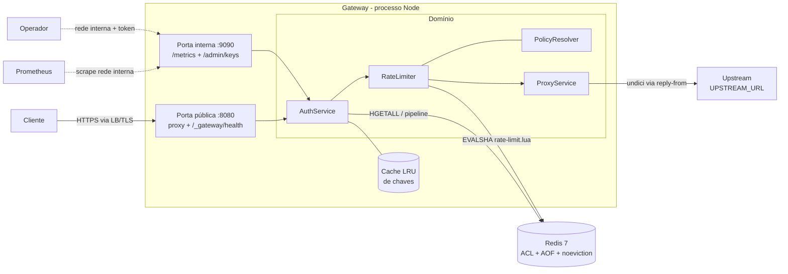

# RateLimitGateway — Plano de implementação

> Tradução de [plan.md](plan.md). Em caso de divergência, a versão em inglês prevalece.

> **Status:** aprovado em 2026-11-22.
> **Versão:** v2, a revisão de arquitetura e segurança feita sobre a v1 (resumida na seção 0).
> Documentos relacionados: [modelo de ameaças](threat-model.pt-BR.md) e
> [ADRs](decisions/README.md).

---

## 0. Mudanças em relação à v1

A v1 tinha a lógica de rate limit sólida, mas a revisão encontrou **quatro falhas de
segurança reais** e dois problemas de arquitetura.

| # | Problema na v1 | Impacto | Correção na v2 |
|---|---|---|---|
| R1 | **SSRF pelo request-target.** Numa requisição em *absolute-form* (`GET http://evil.com/ HTTP/1.1`), o `req.url` do Node vem com URL completa. Com path `//evil.com/x`, `new URL(path, base)` troca o host. | Usar o gateway como proxy aberto para qualquer destino | URL de destino montada **só** a partir de `UPSTREAM_URL` + path validado; absolute-form e `//` são rejeitados (seção 6.4) |
| R2 | **Bypass da política de rota por normalização de path.** `/v1/x/../calculate`, `/v1//calculate`, `/V1/Calculate` ou `%2e%2e` não casam com o prefixo `/v1/calculate`, mas o upstream pode normalizar para ele | A política por rota é contornada | Validação estrita do path antes do matching e matching sem diferenciar maiúsculas (seção 6.4) |
| R3 | **Auth e limite rodavam depois de ler o corpo.** O `preHandler` do Fastify roda depois do parse do corpo | Cliente sem chave faz o gateway bufferizar 1 MiB por requisição (amplificação de DoS) | Auth e rate limit no hook `onRequest`, **antes** de ler o corpo (seção 2.2) |
| R4 | **Formato de chave quebrado.** `secret` em base64url contém `_` e `-`, então o parse por `_` falha | Bug funcional e ambiguidade no parse | `secret` em base62, com regex de formato fixo (seção 4.1) |
| R5 | **Rotas admin na porta pública,** protegidas só por token | Um token vazado dá controle total pela internet | Admin e `/metrics` numa **porta interna** não publicada; o token continua exigido (defesa em profundidade) |
| R6 | **Guarda de força bruta com um round-trip ao Redis a mais em toda requisição** | Latência no caminho principal | O contador só é consultado no cache miss, no mesmo pipeline do `HGETALL` |
| R7 | Redis sem senha nem ACL no compose | Qualquer processo na rede do compose lê e apaga as chaves | Usuário ACL restrito ao prefixo `rlg:*`, sem comandos perigosos, e Redis não exposto ao host |
| R8 | Nenhum controle de supply chain | Dependência comprometida passaria despercebida | CI com `npm ci`, `npm audit`, Dependabot, CodeQL e actions fixadas por SHA |

Outra mudança, que não é correção: **testes baseados em modelo.** Um modelo de
referência simples em TypeScript, comparado com o Lua em sequências aleatórias de
eventos, prova a lógica muito além de exemplos escolhidos a dedo.

---

## 1. Decisões

### 1.1 Decisões do autor
- **A1.** API keys no Redis com `noeviction` + AOF.
- **A2.** Cache local de chaves validadas (TTL curto); fail-open/closed vale para o rate limit.
- **A3.** Planos e políticas por rota em arquivo de configuração versionado, validado por Zod.
- **A4.** Política do plano e da rota valem juntas (a requisição precisa passar nas duas).

### 1.2 Propostas (aprovadas em 2026-11-22)

| # | Proposta | Muda a especificação? | Status |
|---|---|---|---|
| P1 | Health em `/_gateway/health/{live,ready}` na porta pública | Sim (path) | Aprovada |
| P2 | **Porta interna** (`INTERNAL_PORT`) para `/metrics` e `/admin/keys`, não publicada no compose | Sim (onde as rotas ficam) | Aprovada |
| P3 | Guarda de força bruta: falhas de auth por IP; consultada só no cache miss | Acrescenta funcionalidade | Aprovada |
| P4 | Chave do cliente no header `X-API-Key` | Detalha | Aprovada |
| P5 | Formato `rlg_{live\|test}_<id base62 12>_<secret base62 43>` | Detalha | Aprovada |
| P6 | Políticas em JSON (sem dependência de YAML) | Detalha | Aprovada |
| P7 | Validação estrita de path e URL de destino canônica (R1, R2) | Detalha "validar toda entrada" | Aprovada |
| P8 | Redis com usuário ACL e senha, sem porta exposta ao host | Acrescenta | Aprovada |
| P9 | Supply chain no CI: Dependabot, CodeQL, `npm audit`, actions fixadas por SHA | Acrescenta (sem dependência em runtime) | Aprovada |
| P10 | `fast-check` como dependência **de desenvolvimento**, para testes de propriedade e de modelo | Acrescenta uma dependência de dev | Aprovada |
| P11 | `docs/threat-model.md` (STRIDE) + `SECURITY.md` (como reportar vulnerabilidades) | Acrescenta documentação | Aprovada |

### 1.3 Esclarecimentos aprovados (2026-11-22)

Duas ambiguidades da v2, resolvidas na aprovação:

| # | Esclarecimento | Onde aparece |
|---|---|---|
| C1 | Requisição com header `Upgrade` (inclui h2c e WebSocket) ou com `Connection: upgrade` → **400 `upgrade_not_supported`**, rejeitada no `onRequest` **antes da autenticação**, sem tocar no Redis nem no upstream | 2.2, 6.3, 8.3, 10.6, 13 |
| C2 | O prefixo reservado `/_gateway/` casa **sem diferenciar maiúsculas**. Qualquer variação (`/_GATEWAY/x`, `/_Gateway/x`) que não seja rota de health → **404 `not_found`**, e nunca é repassada ao upstream | 2.2, 6.4, 8.1, 10.6 |

---

## 2. Arquitetura

### 2.1 Visão de componentes



**Estilo:** camadas com portas e adaptadores, numa versão enxuta. O domínio (`auth`,
`ratelimit`, `proxy`) depende de **interfaces** (`KeyStore`, `RateLimitStore`, `Clock`),
não do ioredis. Os adaptadores Redis implementam essas interfaces.

Isso tem três ganhos:
1. Testes unitários do domínio usam fakes em memória: são rápidos e sem Docker.
2. As regras ficam legíveis, sem detalhes de Redis no meio.
3. Trocar o armazenamento das chaves (A1) no futuro mexe num único arquivo.

Não há framework de injeção de dependência: `buildApp(deps)` recebe as dependências
prontas, o que deixa a composição explícita e testável.

### 2.2 Pipeline de uma requisição (ordem dos hooks do Fastify)

A ordem importa para a segurança: **tudo que pode rejeitar barato roda antes de ler o
corpo.**

```mermaid
sequenceDiagram
    autonumber
    participant C as Cliente
    participant G as Gateway
    participant K as Cache local
    participant R as Redis
    participant U as Upstream

    Note over G: onRequest (corpo ainda NÃO foi lido)
    C->>G: POST /v1/calculate + X-API-Key
    G->>G: requestId; Upgrade / Connection: upgrade → 400 (C1)
    G->>G: validação do path (400); prefixo reservado sem diferenciar maiúsculas → 404 (C2)
    G->>G: parse do formato da chave (401 se inválida, sem tocar no Redis)
    G->>K: busca id
    alt cache miss
        G->>R: pipeline: HGETALL rlg:key:{id} + GET rlg:authfail:{ip}
        alt IP acima do limite de falhas
            G-->>C: 429 too_many_auth_failures
        end
        G->>K: guarda registro (TTL)
    end
    G->>G: HMAC + timingSafeEqual (401 + INCR authfail se falhar)
    G->>G: PolicyResolver(plano, método, path)
    G->>R: EVALSHA rate-limit.lua (todas as políticas, tudo ou nada)
    alt bloqueado
        G-->>C: 429 + RateLimit-* + Retry-After
    end
    Note over G: preParsing/parse: lê o corpo com limite (413)
    Note over G: handler: proxy
    G->>U: método + path validado + query + corpo, headers filtrados
    U-->>G: resposta (streaming)
    Note over G: onSend: RateLimit-*, X-Request-Id, remove hop-by-hop
    G-->>C: resposta
```

Uma requisição que é rejeitada (400, 401, 404 ou 429) **nunca** tem o corpo lido. O Node
descarta o corpo quando a resposta é enviada, e a conexão é fechada se o corpo for grande.

### 2.3 Estrutura de pastas

```
.
├── src/
│   ├── index.ts                    # composição: carrega config, cria adaptadores, sobe as 2 portas, shutdown
│   ├── app/
│   │   ├── public-app.ts           # Fastify público: hooks + health + proxy catch-all
│   │   └── internal-app.ts         # Fastify interno: /metrics + /admin/keys
│   ├── config/
│   │   ├── env.ts                  # schema Zod do env (falha rápido, sem mostrar segredos)
│   │   └── policies.ts             # schema Zod do JSON de políticas + validação cruzada
│   ├── domain/                     # regras puras, sem I/O
│   │   ├── api-key.ts              # formato, geração base62 sem viés, HMAC, comparação
│   │   ├── policy-resolver.ts      # (plano, método, path) → políticas
│   │   ├── rate-limit-headers.ts   # escolhe a política mais restritiva → headers
│   │   ├── path-guard.ts           # validação estrita de path (R2) + chave de matching
│   │   └── ports.ts                # interfaces KeyStore, RateLimitStore, AuthFailureStore, Clock
│   ├── services/
│   │   ├── auth-service.ts         # cache + store + guarda de força bruta
│   │   └── key-cache.ts            # LRU com TTL (~40 linhas)
│   ├── adapters/redis/
│   │   ├── client.ts               # ioredis: timeouts curtos, sem fila offline
│   │   ├── key-store.ts            # implementa KeyStore
│   │   ├── rate-limit-store.ts     # implementa RateLimitStore via defineCommand
│   │   └── scripts/rate-limit.lua  # os dois algoritmos + avaliação em duas fases
│   ├── http/
│   │   ├── hooks/                  # request-id, path-guard, auth, rate-limit (todos onRequest)
│   │   ├── proxy/
│   │   │   ├── target-url.ts       # monta a URL de destino canônica (R1)
│   │   │   ├── header-filter.ts    # entrada e saída: hop-by-hop, X-Forwarded, chave, credencial
│   │   │   └── proxy-route.ts      # catch-all com @fastify/reply-from
│   │   ├── admin-routes.ts
│   │   ├── health-routes.ts
│   │   └── errors.ts               # formato único e error handler sem stack trace
│   └── observability/
│       ├── logger.ts               # pino: redact + serializers seguros
│       └── metrics.ts              # registry + definições das métricas
├── config/policies.example.json
├── test/
│   ├── unit/                       # domínio e serviços com fakes
│   ├── property/                   # fast-check: path-guard, api-key, modelo vs Lua
│   ├── integration/                # Redis real (Testcontainers)
│   ├── e2e/                        # gateway completo + Redis + upstream mock
│   ├── security/                   # SSRF, smuggling, path bypass, vazamento em logs
│   └── helpers/                    # container Redis, upstream mock, captura de logs, modelo de referência
├── tools/mock-upstream/            # upstream mock (compose e k6)
├── load/k6/                        # cenários + script de execução
├── deploy/
│   ├── redis.conf                  # AOF, noeviction
│   └── redis-users.acl             # usuário do gateway restrito
├── docs/
│   ├── plan.md / plan.pt-BR.md
│   ├── threat-model.md / threat-model.pt-BR.md
│   └── decisions/                  # ADRs (inglês + pt-BR)
├── .github/
│   ├── workflows/ci.yml            # lint, typecheck, testes, audit
│   ├── workflows/codeql.yml
│   └── dependabot.yml
├── Dockerfile                      # multi-stage, não-root, sem shell no runtime
├── docker-compose.yml              # gateway + redis (+ mock-upstream e k6 por profile)
├── .env.example  .gitignore  .dockerignore  .nvmrc
├── LICENSE  SECURITY.md  README.md  README.pt-BR.md
└── package.json  package-lock.json  tsconfig.json  eslint.config.js  .prettierrc  vitest.config.ts
```

**Regra de dependência entre camadas** (verificada com `no-restricted-imports` do
ESLint):
- `domain/` não importa nada de `adapters/`, `http/` nem bibliotecas de I/O;
- `services/` importa só de `domain/`;
- `http/` e `adapters/` podem importar de `domain/` e `services/`.

### 2.4 Stack e dependências

| Pacote | Tipo | Justificativa |
|---|---|---|
| `fastify` | runtime | servidor HTTP; hooks com ordem clara; traz o pino |
| `@fastify/reply-from` | runtime | proxy sobre undici, mantido pela equipe do Fastify (ADR) |
| `ioredis` | runtime | `defineCommand` (EVALSHA com fallback automático para `NOSCRIPT`), pipelines |
| `zod` | runtime | validação de env, config e entrada |
| `prom-client` | runtime | métricas Prometheus |
| `typescript`, `@types/node`, `tsx` | dev | build e execução em desenvolvimento |
| `vitest`, `testcontainers` | dev | testes e Redis real |
| `fast-check` | dev (P10) | testes de propriedade e de modelo |
| `eslint`, `@eslint/js`, `typescript-eslint`, `eslint-config-prettier`, `prettier` | dev | qualidade |

Ficam de fora, de propósito: dotenv (o Node tem `--env-file`), bibliotecas de LRU, de
UUID (`crypto.randomUUID`) e de YAML (P6), e `@fastify/http-proxy` (camada desnecessária
sobre o reply-from).

**Runtime:** Node 24 LTS (`.nvmrc`, imagem Docker). O CI roda em matriz 22 + 24.
TypeScript com `strict`, `noUncheckedIndexedAccess` e `exactOptionalPropertyTypes`.
Módulos ESM (`"type": "module"`, `module: NodeNext`).

---

## 3. Modelo de ameaças (resumo; versão completa em [threat-model.pt-BR.md](threat-model.pt-BR.md))

**Ativos:** API keys, `API_KEY_PEPPER`, `ADMIN_TOKEN`, credencial do upstream,
disponibilidade do upstream (a API fiscal), integridade dos limites.

**Fronteiras de confiança:**
1. Internet → porta pública
2. Rede interna → porta interna
3. Gateway → Redis
4. Gateway → upstream

| STRIDE | Ameaça | Controle |
|---|---|---|
| **S**poofing | Adivinhar ou forçar uma chave | 256 bits de entropia; guarda de falhas por IP (P3); 401 idêntico para inexistente, revogada e malformada |
| S | Forjar o IP para fugir do limite por IP | `X-Forwarded-*` do cliente descartado; `TRUST_PROXY` só com CIDRs explícitos |
| S | Usar o token admin a partir da internet | Admin só na porta interna (P2) + token com comparação em tempo constante |
| **T**ampering | Corrida para passar do limite | Lua atômico, provado por teste de concorrência + teste de controle |
| T | Path manipulado para fugir da política de rota | Path guard estrito (P7, R2) |
| T | Request smuggling (CL/TE) | Parser estrito do Node (`insecureHTTPParser` desligado); hop-by-hop removido; teste dedicado |
| T | Upgrade de protocolo (h2c, WebSocket) para tunelar tráfego sem passar pelos controles | `Upgrade` ou `Connection: upgrade` → 400 antes da auth (C1) |
| T | Variação de maiúsculas em `/_gateway/` para chegar ao upstream | Prefixo reservado casa sem diferenciar maiúsculas → 404 (C2) |
| **R**epudiation | Ações admin sem rastro | Log de auditoria estruturado em criar e revogar (id da chave, ação, request id; nunca a chave) |
| **I**nformation disclosure | Chave ou token em log | `redact` do pino + serializer sem query string e sem corpo + teste que varre todos os logs da suíte |
| I | Dump do Redis expõe chaves | Só o HMAC é guardado, e sem o pepper o dump é inútil |
| I | Stack trace e detalhes internos em erros | Error handler único; 500 genérico; detalhes só no log |
| I | Enumeração de ids por tempo de resposta | Para id inexistente, o HMAC é calculado mesmo assim e comparado com um valor fixo |
| I | Métricas revelam padrões de clientes | Porta interna; labels sem id de chave |
| **D**oS | Corpos grandes e conexões lentas (slowloris) | Auth antes do corpo (R3); `bodyLimit`; `requestTimeout`, `headersTimeout`, `keepAliveTimeout`; `maxHeaderSize` |
| D | Flood de chaves aleatórias contra o Redis | Formato validado sem Redis; guarda por IP; cache LRU |
| D | Redis lento derruba o gateway | `commandTimeout` curto, sem fila offline, modo de falha configurável |
| D | Upstream lento esgota conexões | `UPSTREAM_TIMEOUT_MS` + limite de conexões do undici |
| **E**levation of privilege | SSRF pelo request-target (R1) | URL de destino canônica; absolute-form e `//` rejeitados |
| E | Gateway comprometido acessa o Redis inteiro | ACL restrita a `rlg:*` e sem comandos perigosos (P8) |
| E | Dependência maliciosa | Lockfile, `npm ci`, audit, Dependabot, CodeQL, poucas dependências (P9) |
| E | Escape do container | Usuário não-root, filesystem read-only, `cap_drop: ALL`, `no-new-privileges` |

**Riscos aceitos e documentados:**
- Uma chave revogada continua valendo até o TTL do cache (padrão 30 s) em outras instâncias.
- O sliding window por contador é aproximado.
- Com fail-open, há uma janela sem limite durante uma queda do Redis.
- Rotação de pepper e de token admin exige restart.
- TLS fica a cargo do load balancer na frente; o gateway aceita `rediss://` para Redis com TLS.

Uma observação honesta, registrada no
[ADR 0008](decisions/0008-api-key-format-and-hmac-pepper.pt-BR.md): como o `secret` é aleatório com 256 bits,
um SHA-256 simples já seria seguro contra força bruta offline. O HMAC com pepper é
**defesa em profundidade**: um dump só do Redis não basta para validar nada.

---

## 4. Segurança das credenciais

### 4.1 API keys
- **Formato:** `rlg_{live|test}_<id>_<secret>`, validado pela regex
  `^rlg_(live|test)_([0-9A-Za-z]{12})_([0-9A-Za-z]{43})$`. O prefixo permite cadastrar um
  padrão no *secret scanning* do GitHub.
- **Geração:**
  - `secret` tem 43 caracteres base62 (~256 bits) e `id` tem 12 (~71 bits, não é segredo);
  - ambos vêm de `crypto.randomBytes` com **rejection sampling**, para não haver viés de
    módulo (descarta bytes ≥ 248 = 4 × 62).
- **Armazenamento:** `HMAC-SHA256(API_KEY_PEPPER, secret)` em hex, mais
  `pepperVersion: "v1"`.
- **Verificação:**
  1. parse da regex;
  2. busca pelo `id`;
  3. HMAC do `secret`;
  4. `crypto.timingSafeEqual` entre buffers de mesmo tamanho.
  Id inexistente ou chave revogada passam pelo mesmo cálculo e produzem a mesma resposta.
- **Exibição:** a chave completa aparece só na resposta `201` da criação. Listagens
  mostram `keyPreview` (`rlg_live_<id>_…`).

### 4.2 Token admin
- Exigido mesmo na porta interna, com `Authorization: Bearer`.
- Comparação: `timingSafeEqual(sha256(recebido), sha256(ADMIN_TOKEN))`. Os digests têm
  tamanho fixo, então o tamanho do token não vaza.
- Falhas de auth admin contam para a guarda por IP.

### 4.3 Segredos de configuração
- O Zod exige no mínimo 32 caracteres em `API_KEY_PEPPER` e `ADMIN_TOKEN`, e rejeita
  valores iguais aos placeholders do `.env.example`.
- Mensagens de erro de configuração citam o nome da variável, **nunca o valor**.

---

## 5. Rate limiting

### 5.1 Algoritmos

**Token bucket.** Capacidade `C`, recarga `r` tokens/s. Permite rajadas de até `C` e
mantém a média `r`.

**Sliding window por contador (ADR).** Mantém a contagem da janela atual (`c`) e da
anterior (`p`). A estimativa é `p × (1 − f) + c`, onde `f` é a fração já percorrida da
janela atual.

Comparação com o log em ZSET:
- o log é exato, mas usa memória proporcional ao limite (O(limite) por sujeito);
- o contador usa O(1), mas supõe tráfego uniforme na janela anterior.

**Garantia testada:** a estimativa nunca passa do limite, e numa janela nova passam
exatamente `limit` requisições.

### 5.2 Modelo de dados no Redis

| Chave | Tipo | Conteúdo | TTL |
|---|---|---|---|
| `rlg:key:<id>` | HASH | `hash`, `pepperVersion`, `plan`, `name`, `status`, `createdAt`, `revokedAt` | nenhum |
| `rlg:keys:index` | ZSET | `id` → `createdAt` (paginação) | nenhum |
| `rlg:rl:tb:{key:<id>}:<policyId>` | HASH | `tokens` (float), `ts` (ms) | `ceil(C/r)` + 1 s |
| `rlg:rl:sw:{key:<id>}:<policyId>` | HASH | `w` (índice da janela), `c`, `p` | 2 × janela |
| `rlg:authfail:{ip:<addr>}` | STRING | contador | `AUTH_FAILURE_WINDOW_MS` |

- `policyId` vale `plan:<nome>` ou `route:<id>`.
- A hash tag `{key:<id>}` coloca todas as políticas de um sujeito no mesmo slot, então o
  esquema continua compatível com Redis Cluster sem custo.
- Chave de limite ausente equivale a "cheio/zerado", então a expiração por TTL nunca
  muda o resultado.
- Quando a memória enche (`noeviction`), as escritas falham, e o modo de falha decide o
  que acontece.

### 5.3 Script Lua (pseudocódigo)

Um único `rate-limit.lua`, registrado com `defineCommand` (EVALSHA com reenvio
automático em `NOSCRIPT`).

```lua
-- KEYS[i] = estado da política i
-- ARGV[1] = now_ms ("" em produção → usa TIME; só os testes enviam valor)
-- ARGV[2] = n; depois, para cada política: alg ("tb"|"sw"), p1, p2
--   tb: p1 = capacity, p2 = refill por segundo
--   sw: p1 = limit,    p2 = janela em ms

local function now_ms()
  if ARGV[1] ~= "" then return tonumber(ARGV[1]) end
  local t = redis.call("TIME")                    -- {segundos, microssegundos}
  return tonumber(t[1]) * 1000 + math.floor(tonumber(t[2]) / 1000)
end

local function token_bucket(key, cap, refill_s, now)
  local rate = refill_s / 1000                    -- tokens por ms
  local tokens, ts = HMGET(key, "tokens", "ts")
  if tokens == nil then tokens, ts = cap, now end
  tokens = min(cap, tokens + max(0, now - ts) * rate)   -- recarga proporcional
  local allowed = tokens >= 1
  local after = allowed and (tokens - 1) or tokens
  return { allowed, cap, floor(after),
           ceil((cap - after) / rate),                  -- reset: até encher
           allowed and 0 or ceil((1 - tokens) / rate),  -- retry: até ter 1 token
           commit = HSET(key, tokens=after, ts=now) + PEXPIRE(key, ceil(cap/rate) + 1000) }
end

local function sliding_window(key, limit, win, now)
  local idx = floor(now / win)
  local w, c, p = HMGET(key, "w", "c", "p")
  if w == nil           then w, c, p = idx, 0, 0
  elseif idx == w + 1   then w, c, p = idx, 0, c    -- virou uma janela
  elseif idx >  w + 1   then w, c, p = idx, 0, 0    -- ficou mais de uma janela parado
  end
  local f = (now - idx * win) / win
  local est = p * (1 - f) + c
  local allowed = est + 1 <= limit
  local left = (idx + 1) * win - now
  local retry = 0
  if not allowed then
    if c + 1 <= limit then                           -- então p > 0: espera o peso de p cair
      retry = ceil(((1 - (limit - c - 1) / p) - f) * win)
    else                                             -- só na próxima janela, quando c vira p
      retry = left + ceil(max(0, 1 - (limit - 1) / c) * win)
    end
  end
  local c_after = allowed and (c + 1) or c
  return { allowed, limit, max(0, floor(limit - est - (allowed and 1 or 0))),
           (c_after > 0) and (left + win) or left,
           retry,
           commit = HSET(key, w=w, c=c_after, p=p) + PEXPIRE(key, 2 * win) }
end

-- Fase 1: avalia tudo, sem gravar
local now, all_ok, out = now_ms(), true, {}
for i = 1, n do
  local r = (alg[i] == "tb") and token_bucket(KEYS[i], ...) or sliding_window(KEYS[i], ...)
  all_ok = all_ok and r.allowed
  out[i] = r
end
-- Fase 2: grava só se TODAS permitiram (sem consumo parcial)
if all_ok then for each r: r.commit() end
-- floor/ceil explícitos: o Redis trunca números Lua para inteiro na resposta
return flatten({allowed and 1 or 0, limit, remaining, reset_ms, retry_ms} for each r)
```

Requisitos de ambiente: Redis 7 (o script usa `TIME` e conta com a replicação por
efeitos, que é o padrão).

**`now_ms` injetável:** o `RateLimitStore` recebe um `Clock` opcional. Em produção o
clock não é passado e o argumento vai vazio. O teste de arquitetura garante que nenhum
código em `src/` passa `now_ms`, só os testes.

### 5.4 Políticas

```json
{
  "plans": {
    "free": { "algorithm": "token_bucket",   "capacity": 20,  "refillPerSecond": 1 },
    "pro":  { "algorithm": "sliding_window", "limit": 1000,   "windowSeconds": 60 }
  },
  "routes": [
    { "id": "calculate", "method": "POST", "pathPrefix": "/v1/calculate",
      "plans": ["free"], "algorithm": "sliding_window", "limit": 30, "windowSeconds": 60 }
  ]
}
```

Validação na inicialização. O processo não sobe se alguma regra falhar:
- ids únicos;
- planos citados em `routes` precisam existir;
- `pathPrefix` precisa passar pelo path guard;
- números inteiros positivos, com teto razoável;
- `capacity ≥ 1`.

Matching: o prefixo mais longo vence. A comparação ignora maiúsculas e só casa em
fronteira de segmento (`/v1/calculate` casa com `/v1/calculate/x`, mas não com
`/v1/calculatex`).

### 5.5 Headers
- `RateLimit-Limit`, `RateLimit-Remaining`, `RateLimit-Reset` (segundos relativos,
  arredondados para cima) em toda resposta que passou pelo limite. No 429 também vai
  `Retry-After` (inteiro ≥ 1).
- Com várias políticas: se a requisição foi bloqueada, os headers mostram a política com
  maior `retry`; se foi permitida, a de menor `remaining`.
- O ADR registra que esse trio vem das primeiras versões do draft da IETF e que versões
  posteriores passaram a usar `RateLimit`/`RateLimit-Policy`.

---

## 6. Proxy

### 6.1 Biblioteca
`@fastify/reply-from` (ADR): undici por baixo, streaming da resposta, mantido pela equipe
do Fastify. A filtragem de headers e a URL de destino são **código nosso**, não o padrão
da biblioteca.

### 6.2 Corpo
- Content-type parser genérico em buffer, com `BODY_LIMIT_BYTES` (padrão 1 MiB) → 413.
- O corpo só é lido depois que auth e limite passaram (R3).
- Streaming de corpos grandes fica fora do escopo.

### 6.3 Headers

**Na requisição ao upstream:**
- **Remove:**
  - `X-API-Key`;
  - os hop-by-hop (`Connection`, `Keep-Alive`, `Proxy-Authenticate`,
    `Proxy-Authorization`, `TE`, `Trailer`, `Transfer-Encoding`, `Upgrade`) e qualquer
    header listado dentro de `Connection`;
  - `Forwarded`, `X-Forwarded-*` e `X-Real-IP` vindos do cliente;
  - `Host`, que é recalculado a partir do upstream.
- **Adiciona:** `X-Forwarded-For` (o IP resolvido, sem a cadeia do cliente),
  `X-Forwarded-Proto`, `X-Request-Id`, e a credencial do upstream quando configurada (ela
  sobrescreve o mesmo header que viesse do cliente).

**Upgrade de protocolo (C1):** antes de qualquer remoção, uma requisição que traga o header
`Upgrade` (h2c, WebSocket ou outro) ou que tenha `upgrade` entre os tokens de `Connection`
é rejeitada com 400 `upgrade_not_supported` no `onRequest`, antes da autenticação. Por isso
a remoção do `Upgrade` acima é só uma segunda camada.

**Na resposta ao cliente:**
- remove os hop-by-hop;
- remove `Server` e `X-Powered-By` vindos do upstream;
- adiciona `X-Request-Id` e os headers `RateLimit-*`.

### 6.4 Path guard e URL de destino (R1, R2)

O path guard roda em `onRequest`. Se o path é rejeitado, a resposta é 400
`invalid_path`, sem tocar no Redis.

**É rejeitado:**
- request-target que não começa com `/`, ou seja, absolute-form (`http://...`) e
  authority-form;
- path que começa com `//`;
- segmentos vazios (`/a//b`), `.` ou `..`;
- `\` ou caracteres de controle;
- percent-encoding de `/`, `\`, `.` ou NUL (`%2F`, `%5C`, `%2E`, `%00`), em qualquer caixa;
- percent-encoding malformado;
- path com mais de 2.048 bytes.

**Prefixo reservado (C2):** depois da validação, se o path começa com `/_gateway/` sem
diferenciar maiúsculas (`/_GATEWAY/x`, `/_Gateway/x`), ele é tratado pelo gateway. Só as
rotas de health exatas respondem; qualquer outra variação → 404 `not_found`. Esses paths
**nunca** são repassados ao upstream.

**Chave de matching:** o path validado em minúsculas, usado **só** para escolher a
política. O path enviado ao upstream é o **mesmo** path validado, sem nenhuma
re-normalização. Assim, o path que foi avaliado é exatamente o que o upstream recebe.

**URL de destino:**
- `origin` + `basePath` saem de `new URL(UPSTREAM_URL)`, calculados uma vez na
  inicialização;
- a URL final é `origin + basePath + pathValidado + search`, montada por concatenação;
- **nunca** se usa `new URL(req.url, base)`;
- uma asserção final confere que `target.origin === upstream.origin`.

### 6.5 Timeouts e limites do servidor

| Configuração | Padrão | Protege contra |
|---|---|---|
| `requestTimeout` | 30 s | requisições que nunca terminam |
| `headersTimeout` (Node) | 10 s | slowloris nos headers |
| `keepAliveTimeout` | 5 s | conexões ociosas |
| `maxHeaderSize` | 16 KiB (padrão do Node) | headers gigantes |
| `bodyLimit` | 1 MiB | corpos grandes |
| `UPSTREAM_TIMEOUT_MS` | 10 s | upstream lento → 504 |
| conexões do undici por origin | 128 | esgotar sockets |

---

## 7. Falha do Redis e autenticação

- **ioredis:** `commandTimeout` de 50 ms, `enableOfflineQueue: false`,
  `maxRetriesPerRequest: 1`, reconexão com backoff.
- **Autenticação:**
  - chave no cache LRU (TTL `AUTH_CACHE_TTL_MS`, padrão 30 s; capacidade
    `AUTH_CACHE_MAX`, padrão 10.000) → segue;
  - chave fora do cache com Redis fora → **503**, independente do modo;
  - só chaves válidas entram no cache (não há cache negativo);
  - a revogação invalida o cache na hora na instância que revogou.
- **Rate limit:** `REDIS_FAILURE_MODE=open` deixa passar **sem** headers `RateLimit-*`,
  incrementa `rlg_ratelimit_fail_open_total` e registra log `warn`, com no máximo um log
  por segundo para não inundar os logs. `closed` responde 503.
- **Guarda de força bruta:** com o Redis fora, ela é ignorada, e isso fica registrado em
  log.

---

## 8. Contrato da API

### 8.1 Porta pública (`PORT`, padrão 8080)

| Método | Rota | Auth | Resposta |
|---|---|---|---|
| `*` | qualquer path fora de `/_gateway/` | `X-API-Key` | resposta do upstream |
| `GET` | `/_gateway/health/live` | nenhuma | `200 {"status":"ok"}` |
| `GET` | `/_gateway/health/ready` | nenhuma | `200` se o Redis responde a `PING`, senão `503`; o corpo não traz detalhes |
| `*` | outro path sob `/_gateway/`, sem diferenciar maiúsculas (C2) | n/a | `404 not_found` (nunca é repassado ao upstream) |

### 8.2 Porta interna (`INTERNAL_PORT`, padrão 9090; não publicada)

| Método | Rota | Auth | Resposta |
|---|---|---|---|
| `GET` | `/metrics` | nenhuma | formato Prometheus |
| `POST` | `/admin/keys` | Bearer | `201 {id, key, name, plan, createdAt}` |
| `GET` | `/admin/keys?limit=1..100&cursor=` | Bearer | `200 {items[], nextCursor}` |
| `DELETE` | `/admin/keys/:id` | Bearer | `204`; `404` se não existir; revogar de novo dá `204` |

Corpo do `POST`: `{"name": "1–64 [A-Za-z0-9 _.-]", "plan": "<plano existente>"}`, em
modo Zod `strict` (campos extras → 400).

### 8.3 Formato de erro

```json
{ "error": { "code": "rate_limited", "message": "Rate limit exceeded.",
             "requestId": "…", "retryAfterSeconds": 3 } }
```

| HTTP | `code` |
|---|---|
| 400 | `validation_error`, `invalid_path`, `upgrade_not_supported` (C1) |
| 401 | `missing_api_key`, `invalid_api_key` (resposta idêntica para malformada, inexistente e revogada), `unauthorized` (admin) |
| 404 | `not_found` |
| 413 | `payload_too_large` |
| 429 | `rate_limited`, `too_many_auth_failures` |
| 500 | `internal_error` |
| 502 | `upstream_unavailable` |
| 503 | `service_unavailable` |
| 504 | `upstream_timeout` |

### 8.4 Variáveis de ambiente

| Variável | Padrão | Observação |
|---|---|---|
| `PORT` / `INTERNAL_PORT` | 8080 / 9090 | |
| `UPSTREAM_URL` | obrigatória | http(s); pode ter path base |
| `UPSTREAM_TIMEOUT_MS` | 10000 | |
| `UPSTREAM_AUTH_HEADER` + `UPSTREAM_AUTH_VALUE` | opcionais | sempre juntas |
| `REDIS_URL` | obrigatória | aceita `rediss://` e usuário:senha |
| `REDIS_FAILURE_MODE` | `open` | `open` \| `closed` |
| `API_KEY_PEPPER`, `ADMIN_TOKEN` | obrigatórias | ≥ 32 caracteres, diferentes dos placeholders |
| `API_KEY_ENV` | `live` | `live` \| `test` |
| `TRUST_PROXY` | `false` | `false` ou lista de CIDRs |
| `BODY_LIMIT_BYTES` | 1048576 | |
| `AUTH_CACHE_TTL_MS` / `AUTH_CACHE_MAX` | 30000 / 10000 | |
| `AUTH_FAILURE_LIMIT` / `AUTH_FAILURE_WINDOW_MS` | 20 / 900000 | |
| `POLICIES_FILE` | `config/policies.json` | |
| `LOG_LEVEL` | `info` | |

---

## 9. Observabilidade

**Logs (pino, JSON).**
- Uma linha por requisição com: `requestId`, método, **path sem query**, status, plano,
  `keyId`, `durationMs`, `upstreamMs` e resultado do limite.
- `redact` em `x-api-key`, `authorization`, `cookie`, `set-cookie` e no header da
  credencial do upstream.
- Corpos nunca são registrados.
- Ações admin geram log de auditoria com `event: "admin.key.created" | "admin.key.revoked"`.

**Métricas** (prefixo `rlg_`):

| Métrica | Tipo | Labels |
|---|---|---|
| `rlg_requests_total` | counter | `plan`, `outcome` (`allowed`, `rate_limited`, `unauthorized`, `invalid`, `error`) |
| `rlg_gateway_overhead_seconds` | histogram | `plan` |
| `rlg_upstream_duration_seconds` | histogram | `status_class` |
| `rlg_upstream_errors_total` | counter | `kind` (`timeout`, `connection`) |
| `rlg_redis_failures_total` | counter | `operation` (`auth`, `ratelimit`, `health`) |
| `rlg_ratelimit_fail_open_total` | counter | nenhuma |
| `rlg_auth_failures_total` | counter | `reason` (`missing`, `invalid`, `blocked_ip`) |
| métricas padrão de processo | | |

**Cardinalidade:** as labels nunca usam id de chave, IP ou path cru. `plan` vem de um
conjunto fechado, o da configuração.

**Health:**
- `live` não toca em dependências;
- `ready` faz `PING` com timeout de 200 ms;
- durante o shutdown, `ready` passa a responder 503 antes de o servidor fechar (drenagem).

---

## 10. Estratégia de testes

**Meta de cobertura:** 90% de linhas em `domain/` e `services/`, verificada no CI. Fora
disso, o critério é ter testes que exercitem os comportamentos, não um número.

### 10.1 Unitários (`test/unit`, sem I/O, fakes das portas)
- `api-key`: formato; alfabeto base62; unicidade em 10 mil chaves; HMAC muda com o
  pepper; a comparação rejeita hash diferente e tamanho diferente; parse rejeita variações.
- `policy-resolver`: prefixo mais longo; fronteira de segmento; método; plano; sem
  maiúsculas.
- `rate-limit-headers`: escolha da política, arredondamentos, `Retry-After ≥ 1`.
- `key-cache`: TTL, LRU, invalidação.
- `auth-service`: cache hit e miss; guarda de força bruta; Redis fora com e sem cache.
- `header-filter` e `target-url`: cada regra da seção 6.
- `env` e `policies`: válidos passam; cada inválido falha com mensagem **sem o valor**.

### 10.2 Propriedade (`test/property`, fast-check, P10)
- **Path guard:** para qualquer string aceita, a URL de destino tem o mesmo origin do
  upstream e nenhum segmento `.` ou `..` depois de decodificada.
- **API key:** gerar e depois fazer parse devolve os mesmos `id` e `secret`; nenhuma
  string fora da regex passa no parse.
- **Modelo vs Lua (o teste principal):** sequências aleatórias de
  `(avanço de tempo, requisição)` rodadas no **modelo de referência em TS** e no
  **script Lua em Redis real** devem produzir as mesmas decisões e os mesmos headers.
  O modelo de referência é escrito para ser óbvio, não rápido.

### 10.3 Integração (`test/integration`, Testcontainers)
O tempo é controlado por `now_ms`, sem `sleep`.
- **Token bucket:** rajada até `C`; bloqueio; recarga proporcional; teto em `C`;
  `retry`/`reset` corretos.
- **Sliding window:** exatamente `limit` numa janela nova; decaimento na virada; reset
  depois de duas janelas; seguir o `retry` informado resulta em requisição permitida.
- **Duas fases:** com plano permitindo e rota bloqueando, o estado do plano fica
  **inalterado**.
- **TTL:** as chaves expiram e voltam ao estado cheio.
- **Key store:** CRUD, paginação, revogação idempotente.
- **ACL:** com o usuário restrito, `FLUSHALL`, `KEYS` e chaves fora de `rlg:*` são
  negados.

### 10.4 Concorrência
- 1.000 chamadas simultâneas em 20 conexões Redis independentes, com limite 100 →
  **exatamente 100**, nos dois algoritmos.
- **Controle:** a implementação ingênua (GET → decide → SET em TS, com `setImmediate`
  entre leitura e escrita), no mesmo harness, permite **mais** que 100, e o teste afirma
  isso.
- **E2E:** duas instâncias do gateway compartilhando o Redis respeitam juntas o mesmo
  limite.

### 10.5 E2E (`test/e2e`)
O fluxo completo, com upstream mock (servidor HTTP em porta aleatória que devolve o que
recebeu):
- chave válida → 200 com headers `RateLimit-*`; sem chave → 401; chave revogada → 401
  depois do TTL do cache; estouro → 429.
- O corpo **não** é lido quando a auth falha (o mock de upstream não recebe nada e o
  socket é fechado).
- Método, path, query e corpo (incluindo binário) chegam intactos; 413, 502 e 504.

### 10.6 Segurança (`test/security`)
- **SSRF:** absolute-form, `//evil.com`, `/%2F%2Fevil.com`, `@`, mistura de barras →
  400, e o mock de upstream **nunca** recebe a requisição.
- **Bypass de rota:** `/v1/x/../calculate`, `/v1//calculate`, `/V1/CALCULATE`,
  `/v1/%2e%2e/calculate` → 400 ou caem na política certa.
- **Smuggling:** `Content-Length` + `Transfer-Encoding` juntos, e `Content-Length`
  duplicado → rejeitados.
- **Upgrade (C1):** `Upgrade: websocket`, `Upgrade: h2c` (com `HTTP2-Settings`) e
  `Connection: keep-alive, Upgrade` → 400 `upgrade_not_supported`, mesmo sem `X-API-Key`.
  Nenhum comando chega ao Redis e o mock de upstream não recebe nada.
- **Prefixo reservado (C2):** `/_GATEWAY/x`, `/_Gateway/admin/keys` e
  `/_gateway/HEALTH/unknown` → 404 `not_found`, e o mock de upstream não recebe nada.
- **Headers:** um `X-Forwarded-For` falso não afeta o IP usado na guarda; `X-API-Key`
  nunca chega ao upstream.
- **Vazamento:** um transport do pino captura **todos** os logs da suíte, e o teste
  afirma que nenhuma chave gerada, o `ADMIN_TOKEN`, o pepper nem a credencial do upstream
  aparecem.
- **Erros:** um 500 forçado não expõe stack trace nem mensagem interna.
- **Enumeração:** as respostas para id inexistente e para secret errado são idênticas,
  byte a byte.

### 10.7 Falhas
- Redis parado no meio do teste (`container.stop()`):
  - modo `open` → passa sem headers; modo `closed` → 503;
  - chave em cache continua autenticando; chave fora do cache → 503;
  - `ready` → 503; as métricas incrementam.
- Redis volta → o gateway se recupera sem restart.

### 10.8 Carga (k6, via `docker compose --profile load`)
- **Linha de base:** k6 direto no mock de upstream.
- **Overhead:** a mesma carga passando pelo gateway, dentro do limite. A diferença de
  p50, p95 e p99 é a latência que o gateway adiciona.
- **Rajada:** acima do limite; a contagem de 429 tem que bater com o esperado pela
  política.
- O README registra só números de execuções reais, com a máquina, os recursos dos
  containers e as versões usadas.

---

## 11. Docker, CI e supply chain

**Dockerfile** (multi-stage):
- `deps` (`npm ci`) → `build` (`tsc`) → `runtime`, com `node:24-alpine` fixado por
  digest, só `dist/` e as dependências de produção (`npm ci --omit=dev`);
- `USER node`;
- `HEALTHCHECK` chamando `/_gateway/health/live` com o próprio Node (sem curl na imagem).

**Compose:**
- Gateway com `read_only: true`, `tmpfs: /tmp`, `cap_drop: [ALL]`,
  `security_opt: [no-new-privileges:true]` e limites de memória e CPU.
- Redis com `deploy/redis.conf` + ACL, **sem `ports:`** (só a rede interna), e volume para
  o AOF.
- Porta interna do gateway **não publicada**; para acessar localmente, usar
  `docker compose exec`.
- Profiles `dev` (mock-upstream) e `load` (mock-upstream + k6).

**CI** (`.github/workflows/ci.yml`):
- `permissions: contents: read`;
- actions fixadas por SHA;
- matriz Node 22 e 24;
- passos: `npm ci` → lint → typecheck → unit + property → integration + e2e + security
  (Docker do runner) → cobertura → `npm audit --omit=dev --audit-level=high`.

**Também:** `codeql.yml` (análise de JS/TS, gratuita para repositório público) e
`dependabot.yml` (npm e github-actions, semanal).

**Do seu lado, nas configurações do GitHub:** ativar *secret scanning* + *push
protection* e proteger o branch `main` (CI obrigatório antes do merge).

---

## 12. Marcos

Critério comum a todos os marcos:
- lint, typecheck e testes verdes, localmente e no CI;
- `docs/plan.md` e `plan.pt-BR.md` atualizados;
- commit em Conventional Commits, com o e-mail noreply;
- resumo para você (o que foi feito, como verificar e o próximo passo).

| # | Marco | Entregas | Critério de pronto específico | Status |
|---|---|---|---|---|
| **M0** | Documentação base | `plan.md`/`plan.pt-BR.md`, `threat-model` (2 idiomas), ADRs 0001–0008 (2 idiomas), `.gitignore`, `LICENSE`, `SECURITY.md` | Arquivos no `main`; rascunho removido | ✅ Concluído |
| **M1** | Fundação | `package.json` + lockfile, tsconfig estrito, ESLint (com regra de camadas) e Prettier, Vitest, `env.ts`, `policies.ts`, `logger.ts`, `errors.ts`, `public-app` com `/_gateway/health/live`, CI + CodeQL + Dependabot | CI verde no GitHub; o teste de config prova que segredos não aparecem em erros | Pendente |
| **M2** | Rate limiting | `ports.ts`, `rate-limit.lua`, `rate-limit-store.ts`, modelo de referência, helpers do Testcontainers | Integração dos dois algoritmos + duas fases; propriedade modelo vs Lua (≥ 1.000 sequências); concorrência exata em 100/1.000; controle ingênuo falhando | Pendente |
| **M3** | API keys e admin | `api-key.ts`, `key-store.ts`, `key-cache.ts`, `internal-app` com `/admin/keys`, log de auditoria | Unitários + propriedade de chave; CRUD integrado; a chave aparece só no 201; teste de enumeração idêntica | Pendente |
| **M4** | Proxy | `path-guard.ts`, `target-url.ts`, `header-filter.ts`, `proxy-route.ts`, timeouts, limite de corpo | Todos os testes de proxy e `test/security` de SSRF, bypass, smuggling, Upgrade (C1) e prefixo reservado (C2) verdes | Pendente |
| **M5** | Pipeline completo | Hooks `onRequest` (upgrade → path → auth → guarda → limite), headers no `onSend`, `auth-service` | E2E completo; corpo não lido em 400/401/404/429; Upgrade rejeitado antes da auth (C1); duas instâncias respeitando o mesmo limite | Pendente |
| **M6** | Resiliência e observabilidade | Modos open/closed, `ready` com drenagem, todas as métricas, teste de vazamento em logs | Testes de Redis parado e recuperação; `/metrics` com todas as séries; varredura de logs limpa | Pendente |
| **M7** | Container | Dockerfile, compose endurecido, `redis.conf` + ACL, mock-upstream, `.env.example`, `scripts/smoke.sh` | `docker compose up` sobe tudo; o smoke script (criar chave → chamar → 429 → revogar → 401) passa; teste de ACL verde | Pendente |
| **M8** | Carga e documentação | Cenários k6, execução real, `README.md` + `README.pt-BR.md` completos | Números reais no README (ou instruções, se não der para rodar); docs batem com o código; revisão final do threat model | Pendente |

**ADRs** (cada um em inglês + pt-BR, índice em [decisions/README.md](decisions/README.md)):
1. [Lua para atomicidade](decisions/0001-lua-atomicity.pt-BR.md)
2. [Sliding window por contador](decisions/0002-sliding-window-counter.pt-BR.md)
3. [Avaliação em duas fases de várias políticas](decisions/0003-two-phase-multi-policy-evaluation.pt-BR.md)
4. [Chaves no Redis com noeviction + AOF](decisions/0004-api-keys-in-redis-noeviction-aof.pt-BR.md)
5. [Modos de falha e cache de autenticação](decisions/0005-failure-modes-and-auth-cache.pt-BR.md)
6. [`@fastify/reply-from` como proxy](decisions/0006-fastify-reply-from-proxy.pt-BR.md)
7. [Formato dos headers de rate limit](decisions/0007-rate-limit-headers-format.pt-BR.md)
8. [Formato da chave e HMAC com pepper](decisions/0008-api-key-format-and-hmac-pepper.pt-BR.md)

---

## 13. Fora do escopo

- Interface gráfica, OAuth, multi-região, billing (como na especificação).
- Rotação de pepper e de token sem restart.
- Redis Cluster (o esquema de chaves já é compatível).
- Streaming de corpos grandes.
- TLS no próprio gateway (fica a cargo do load balancer).
- WebSockets, h2c e qualquer `Upgrade` (requisições com `Upgrade` ou `Connection: upgrade`
  são rejeitadas com 400 `upgrade_not_supported`; ver C1).
