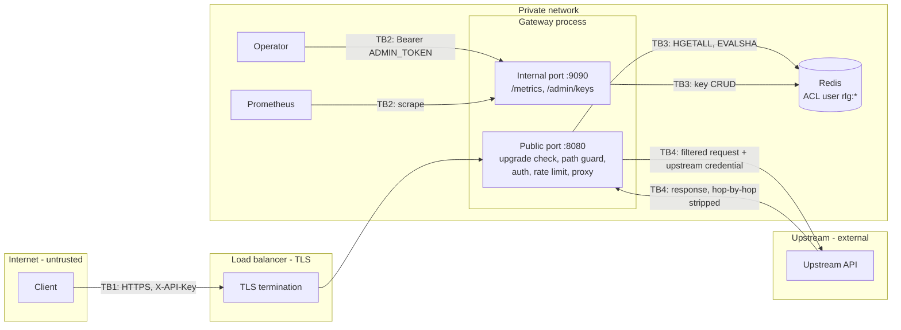

# RateLimitGateway — Threat Model

> Portuguese translation: [threat-model.pt-BR.md](threat-model.pt-BR.md). This English
> version prevails in case of divergence.

This document expands section 3 of the [implementation plan](plan.md). It uses STRIDE and
maps each control to the milestone that implements it and to the test that verifies it.
It is reviewed at the end of every milestone that touches a control, and in full in M8.

## 1. Scope

**In scope:** the gateway process (public and internal ports), its Redis instance, the
connection to the configured upstream, the container image and compose setup, and the CI
pipeline that builds it.

**Out of scope:** the upstream application itself (the tax-calculation API), the load
balancer / TLS terminator in front of the gateway, the host OS, and the Prometheus server.
These are treated as external components with their own controls.

**Assumptions:**
- TLS is terminated by a load balancer in front of the gateway.
- The internal port (`INTERNAL_PORT`) and Redis are reachable only from a private network.
- Secrets (`API_KEY_PEPPER`, `ADMIN_TOKEN`, upstream credential, Redis password) are
  provided through the environment and never committed.

## 2. Assets

| Asset | Why it matters |
|---|---|
| Client API keys | Grant access to the upstream under a plan's limits |
| `API_KEY_PEPPER` | Needed to validate any key; with a Redis dump, enables offline verification |
| `ADMIN_TOKEN` | Creates and revokes keys |
| Upstream credential | Grants direct access to the upstream, bypassing the gateway |
| Upstream availability | The tax API in production must not be overloaded |
| Integrity of the limits | The product guarantee: a plan never exceeds its quota |
| Redis data | Key records (hashes, plans, status) and rate-limit state |

## 3. Trust boundaries and data flow

| # | Boundary | Untrusted side |
|---|---|---|
| TB1 | Internet → public port | Every client, authenticated or not |
| TB2 | Internal network → internal port | Operators and Prometheus (trusted network, still token-protected for admin) |
| TB3 | Gateway → Redis | Redis is trusted for data, but access is restricted by ACL |
| TB4 | Gateway → upstream | Upstream responses are untrusted (headers are filtered) |

## 4. STRIDE analysis

Milestones and test locations follow the [plan](plan.md) (sections 10 and 12). "Not
automated" means the control is verified by manual review or by CI configuration, not by a
test in the suite.

| ID | STRIDE | Threat | Control | Milestone | Verifying test |
|---|---|---|---|---|---|
| S1 | Spoofing | Guessing or brute-forcing an API key | 256-bit secret; per-IP failure guard (P3); identical 401 for malformed, unknown and revoked | M3, M5 | `test/unit` api-key; `test/unit` auth-service (guard); `test/security` enumeration (byte-identical responses) |
| S2 | Spoofing | Forging the client IP to escape the per-IP guard | Client `X-Forwarded-*`, `Forwarded`, `X-Real-IP` discarded; `TRUST_PROXY` only with explicit CIDRs | M4, M5 | `test/security` headers (fake `X-Forwarded-For` ignored by the guard); `test/unit` header-filter |
| S3 | Spoofing | Using the admin token from the internet | Admin only on the internal port (P2); Bearer token compared in constant time over SHA-256 digests | M3, M7 | `test/integration`/`test/e2e` admin routes (401 `unauthorized`); port not published: Not automated — manual review of compose |
| T1 | Tampering | Concurrent requests racing past the limit | Single atomic Lua script ([ADR 0001](decisions/0001-lua-atomicity.md)) | M2 | `test/integration` concurrency: exactly 100 of 1,000; naive control allows more |
| T2 | Tampering | Partial consumption when plan and route policies both apply | Two-phase evaluation, all or nothing ([ADR 0003](decisions/0003-two-phase-multi-policy-evaluation.md)) | M2 | `test/integration` two phases: plan state unchanged when route blocks |
| T3 | Tampering | Path manipulation to escape the route policy (R2) | Strict path guard; case-insensitive, segment-boundary matching (P7) | M4 | `test/security` route bypass; `test/property` path guard; `test/unit` policy-resolver |
| T4 | Tampering | HTTP request smuggling (CL/TE) | Node strict parser (`insecureHTTPParser` off); hop-by-hop stripped | M4 | `test/security` smuggling (CL+TE, duplicated CL) |
| T5 | Tampering | Protocol upgrade (h2c, WebSocket) to tunnel traffic past the controls | `Upgrade` or `Connection: upgrade` → 400 `upgrade_not_supported` in `onRequest`, before auth (C1) | M4, M5 | `test/security` upgrade: 400 without key, no Redis command, mock upstream receives nothing |
| T6 | Tampering | Case variation of `/_gateway/` (`/_GATEWAY/x`) reaching the upstream | Reserved prefix matched case-insensitively → 404 `not_found` (C2) | M4, M5 | `test/security` reserved prefix: 404 and mock upstream receives nothing |
| T7 | Tampering | Injected `now_ms` used in production to manipulate time | Only tests pass `now_ms`; production sends an empty argument and the script uses `TIME` | M2 | Architecture test: no code in `src/` passes `now_ms` |
| R1 | Repudiation | Admin actions without a trail | Structured audit log (`admin.key.created`, `admin.key.revoked`) with key id and request id, never the key | M3 | Not automated — manual review (the log scan in M6 checks that no secret is logged) |
| I1 | Information disclosure | Key, token or credential written to logs | pino `redact`; serializer without query string or body | M1, M6 | `test/security` leakage: every log of the suite scanned for keys, `ADMIN_TOKEN`, pepper and upstream credential |
| I2 | Information disclosure | Redis dump exposes usable keys | Only `HMAC-SHA256(pepper, secret)` stored ([ADR 0008](decisions/0008-api-key-format-and-hmac-pepper.md)) | M3 | `test/integration` key store (CRUD); `test/unit` api-key (HMAC changes with the pepper) |
| I3 | Information disclosure | Stack traces or internal details in errors | Single error handler; generic 500; details only in the log | M1 | `test/security` errors: forced 500 exposes no stack or internal message |
| I4 | Information disclosure | Configuration errors leak secret values | Zod messages name the variable, never the value | M1 | `test/unit` env/policies: invalid values fail without echoing the value |
| I5 | Information disclosure | Key-id enumeration via response timing | HMAC computed even for unknown ids, compared against a fixed value | M3 | `test/security` enumeration (identical responses); timing: Not automated — code review |
| I6 | Information disclosure | Metrics reveal client patterns | Internal port; labels never contain key id, IP or raw path | M6, M7 | Not automated — code review of metric label definitions and of compose |
| I7 | Information disclosure | API key forwarded to the upstream | `X-API-Key` stripped before proxying | M4 | `test/e2e`/`test/security` headers: mock upstream never receives `X-API-Key` |
| D1 | Denial of service | Unauthenticated large bodies (R3) | Auth and limit in `onRequest`, before reading the body; `bodyLimit` → 413 | M4, M5 | `test/e2e` body not read on 400/401/404/429; 413 test |
| D2 | Denial of service | Slow connections (slowloris), huge headers | `requestTimeout`, `headersTimeout`, `keepAliveTimeout`, `maxHeaderSize` | M4 | Not automated — manual review of server configuration |
| D3 | Denial of service | Flood of random keys hitting Redis | Format validated without Redis; per-IP guard; LRU cache | M3, M5 | `test/unit` api-key (parse rejects variations); `test/unit` auth-service (guard, cache) |
| D4 | Denial of service | Slow or failing Redis stalls the gateway | Short `commandTimeout`, no offline queue, configurable failure mode | M6 | `test/integration` failures: Redis stopped mid-test (open/closed, cache, ready, recovery) |
| D5 | Denial of service | Slow upstream exhausts connections | `UPSTREAM_TIMEOUT_MS` → 504; undici connection limit | M4 | `test/e2e` 504 with slow upstream; connection limit: Not automated — manual review |
| D6 | Denial of service | Gateway overloads the upstream | Per-plan and per-route policies | M2, M5 | `test/e2e` 429 over the limit; two instances share the same limit; k6 burst scenario (M8) |
| E1 | Elevation of privilege | SSRF via the request-target (R1) | Canonical target URL; absolute-form and `//` rejected; origin assertion | M4 | `test/security` SSRF; `test/property` path guard (same origin) |
| E2 | Elevation of privilege | Compromised gateway accesses all of Redis | ACL user restricted to `rlg:*`, without dangerous commands (P8) | M7 | `test/integration` ACL: `FLUSHALL`, `KEYS` and keys outside `rlg:*` denied |
| E3 | Elevation of privilege | Malicious or vulnerable dependency | Lockfile, `npm ci`, `npm audit`, Dependabot, CodeQL, actions pinned by SHA, few dependencies (P9) | M1 | Not automated — CI configuration |
| E4 | Elevation of privilege | Container escape | Non-root user, read-only filesystem, `cap_drop: ALL`, `no-new-privileges` | M7 | Not automated — manual review of Dockerfile and compose |

## 5. Accepted risks

| Risk | Rationale |
|---|---|
| A revoked key stays valid on other instances until the auth-cache TTL (default 30 s) | Keeps auth working during short Redis outages ([ADR 0005](decisions/0005-failure-modes-and-auth-cache.md)); TTL is configurable; the revoking instance invalidates immediately |
| The sliding window counter is approximate | O(1) memory per subject; the estimate never exceeds the limit ([ADR 0002](decisions/0002-sliding-window-counter.md)) |
| With fail-open, requests are not limited during a Redis outage | Availability of the tax API is preferred; the event is logged and counted; `closed` is available |
| Rotating the pepper or the admin token requires a restart | Out of scope; the stored `pepperVersion` field allows rotation later |
| TLS is handled by the load balancer | The gateway accepts `rediss://` for Redis over TLS; plain HTTP inside the private network |
| The brute-force guard is skipped while Redis is down | It depends on Redis; the skip is logged |

**Note on the peppered HMAC:** because each `secret` is random with 256 bits, a plain
SHA-256 would already resist offline brute force. The peppered HMAC is **defense in
depth**: a Redis dump alone is not enough to validate any key
([ADR 0008](decisions/0008-api-key-format-and-hmac-pepper.md)).

## 6. Review log

| Date | Milestone | Change |
|---|---|---|
| 2026-11-22 | M0 | Initial version, from the approved plan v2, including clarifications C1 (protocol upgrade) and C2 (case-insensitive reserved prefix) |
