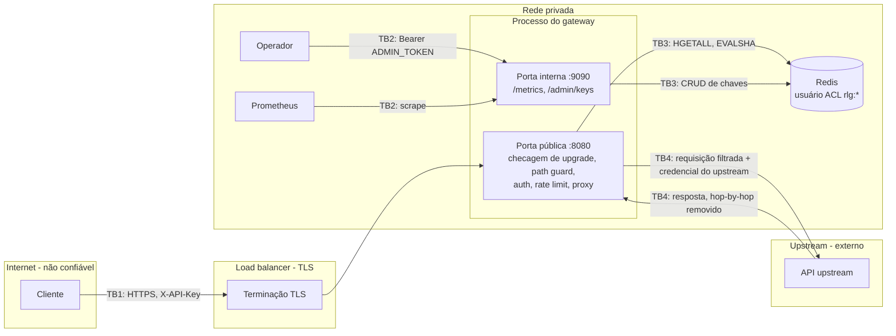

# RateLimitGateway — Modelo de ameaças

> Tradução de [threat-model.md](threat-model.md). Em caso de divergência, a versão em inglês prevalece.

Este documento expande a seção 3 do [plano de implementação](plan.pt-BR.md). Ele usa STRIDE
e liga cada controle ao marco que o implementa e ao teste que o verifica. É revisado ao fim
de todo marco que mexe num controle, e por completo no M8.

## 1. Escopo

**Dentro do escopo:** o processo do gateway (portas pública e interna), a instância de
Redis dele, a conexão com o upstream configurado, a imagem do container e o compose, e o
pipeline de CI que gera tudo isso.

**Fora do escopo:** a aplicação upstream em si (a API de cálculo fiscal), o load balancer /
terminador TLS na frente do gateway, o sistema operacional do host e o servidor Prometheus.
Esses são tratados como componentes externos, com controles próprios.

**Premissas:**
- O TLS é terminado por um load balancer na frente do gateway.
- A porta interna (`INTERNAL_PORT`) e o Redis só são acessíveis por uma rede privada.
- Os segredos (`API_KEY_PEPPER`, `ADMIN_TOKEN`, credencial do upstream, senha do Redis)
  chegam pelo ambiente e nunca são commitados.

## 2. Ativos

| Ativo | Por que importa |
|---|---|
| API keys dos clientes | Dão acesso ao upstream dentro dos limites de um plano |
| `API_KEY_PEPPER` | Necessário para validar qualquer chave; junto com um dump do Redis, permite verificação offline |
| `ADMIN_TOKEN` | Cria e revoga chaves |
| Credencial do upstream | Dá acesso direto ao upstream, contornando o gateway |
| Disponibilidade do upstream | A API fiscal em produção não pode ser sobrecarregada |
| Integridade dos limites | A garantia do produto: um plano nunca passa da cota |
| Dados no Redis | Registros de chave (hashes, planos, status) e estado de rate limit |

## 3. Fronteiras de confiança e fluxo de dados

| # | Fronteira | Lado não confiável |
|---|---|---|
| TB1 | Internet → porta pública | Todo cliente, autenticado ou não |
| TB2 | Rede interna → porta interna | Operadores e Prometheus (rede confiável, mas o admin continua protegido por token) |
| TB3 | Gateway → Redis | O Redis é confiável quanto aos dados, mas o acesso é restrito por ACL |
| TB4 | Gateway → upstream | As respostas do upstream não são confiáveis (os headers são filtrados) |

## 4. Análise STRIDE

Os marcos e os locais dos testes seguem o [plano](plan.pt-BR.md) (seções 10 e 12). "Não
automatizado" significa que o controle é verificado por revisão manual ou pela
configuração do CI, e não por um teste da suíte.

| ID | STRIDE | Ameaça | Controle | Marco | Teste que verifica |
|---|---|---|---|---|---|
| S1 | Spoofing | Adivinhar ou forçar uma API key | Secret de 256 bits; guarda de falhas por IP (P3); 401 idêntico para malformada, inexistente e revogada | M3, M5 | `test/unit` api-key; `test/unit` auth-service (guarda); `test/security` enumeração (respostas idênticas byte a byte) |
| S2 | Spoofing | Forjar o IP do cliente para fugir da guarda por IP | `X-Forwarded-*`, `Forwarded` e `X-Real-IP` do cliente descartados; `TRUST_PROXY` só com CIDRs explícitos | M4, M5 | `test/security` headers (`X-Forwarded-For` falso ignorado pela guarda); `test/unit` header-filter |
| S3 | Spoofing | Usar o token admin a partir da internet | Admin só na porta interna (P2); token Bearer comparado em tempo constante sobre digests SHA-256 | M3, M7 | `test/integration`/`test/e2e` rotas admin (401 `unauthorized`); porta não publicada: Não automatizado — revisão manual do compose |
| T1 | Tampering | Requisições concorrentes passando do limite numa corrida | Um único script Lua atômico ([ADR 0001](decisions/0001-lua-atomicity.pt-BR.md)) | M2 | `test/integration` concorrência: exatamente 100 de 1.000; o controle ingênuo deixa passar mais |
| T2 | Tampering | Consumo parcial quando as políticas do plano e da rota valem juntas | Avaliação em duas fases, tudo ou nada ([ADR 0003](decisions/0003-two-phase-multi-policy-evaluation.pt-BR.md)) | M2 | `test/integration` duas fases: estado do plano inalterado quando a rota bloqueia |
| T3 | Tampering | Manipular o path para fugir da política de rota (R2) | Path guard estrito; matching sem diferenciar maiúsculas e em fronteira de segmento (P7) | M4 | `test/security` bypass de rota; `test/property` path guard; `test/unit` policy-resolver |
| T4 | Tampering | HTTP request smuggling (CL/TE) | Parser estrito do Node (`insecureHTTPParser` desligado); hop-by-hop removido | M4 | `test/security` smuggling (CL+TE, CL duplicado) |
| T5 | Tampering | Upgrade de protocolo (h2c, WebSocket) para tunelar tráfego sem passar pelos controles | `Upgrade` ou `Connection: upgrade` → 400 `upgrade_not_supported` no `onRequest`, antes da auth (C1) | M4, M5 | `test/security` upgrade: 400 sem chave, nenhum comando no Redis, mock de upstream não recebe nada |
| T6 | Tampering | Variação de maiúsculas em `/_gateway/` (`/_GATEWAY/x`) chegando ao upstream | Prefixo reservado casa sem diferenciar maiúsculas → 404 `not_found` (C2) | M4, M5 | `test/security` prefixo reservado: 404 e mock de upstream não recebe nada |
| T7 | Tampering | `now_ms` injetado usado em produção para manipular o tempo | Só os testes passam `now_ms`; em produção o argumento vai vazio e o script usa `TIME` | M2 | Teste de arquitetura: nenhum código em `src/` passa `now_ms` |
| R1 | Repudiation | Ações admin sem rastro | Log de auditoria estruturado (`admin.key.created`, `admin.key.revoked`) com id da chave e request id, nunca a chave | M3 | Não automatizado — revisão manual (a varredura de logs do M6 confere que nenhum segredo é registrado) |
| I1 | Information disclosure | Chave, token ou credencial escritos em log | `redact` do pino; serializer sem query string e sem corpo | M1, M6 | `test/security` vazamento: todos os logs da suíte varridos em busca de chaves, `ADMIN_TOKEN`, pepper e credencial do upstream |
| I2 | Information disclosure | Dump do Redis expõe chaves utilizáveis | Só `HMAC-SHA256(pepper, secret)` é guardado ([ADR 0008](decisions/0008-api-key-format-and-hmac-pepper.pt-BR.md)) | M3 | `test/integration` key store (CRUD); `test/unit` api-key (o HMAC muda com o pepper) |
| I3 | Information disclosure | Stack traces ou detalhes internos em erros | Error handler único; 500 genérico; detalhes só no log | M1 | `test/security` erros: um 500 forçado não expõe stack nem mensagem interna |
| I4 | Information disclosure | Erros de configuração vazam valores de segredos | Mensagens do Zod citam a variável, nunca o valor | M1 | `test/unit` env/policies: valores inválidos falham sem repetir o valor |
| I5 | Information disclosure | Enumeração de ids pelo tempo de resposta | HMAC calculado mesmo para id inexistente, comparado com um valor fixo | M3 | `test/security` enumeração (respostas idênticas); tempo: Não automatizado — revisão de código |
| I6 | Information disclosure | Métricas revelam padrões de clientes | Porta interna; labels nunca têm id de chave, IP ou path cru | M6, M7 | Não automatizado — revisão de código das labels das métricas e do compose |
| I7 | Information disclosure | API key repassada ao upstream | `X-API-Key` removido antes do repasse | M4 | `test/e2e`/`test/security` headers: o mock de upstream nunca recebe `X-API-Key` |
| D1 | Denial of service | Corpos grandes sem autenticação (R3) | Auth e limite no `onRequest`, antes de ler o corpo; `bodyLimit` → 413 | M4, M5 | `test/e2e` corpo não lido em 400/401/404/429; teste de 413 |
| D2 | Denial of service | Conexões lentas (slowloris), headers gigantes | `requestTimeout`, `headersTimeout`, `keepAliveTimeout`, `maxHeaderSize` | M4 | Não automatizado — revisão manual da configuração do servidor |
| D3 | Denial of service | Flood de chaves aleatórias contra o Redis | Formato validado sem Redis; guarda por IP; cache LRU | M3, M5 | `test/unit` api-key (parse rejeita variações); `test/unit` auth-service (guarda, cache) |
| D4 | Denial of service | Redis lento ou fora trava o gateway | `commandTimeout` curto, sem fila offline, modo de falha configurável | M6 | `test/integration` falhas: Redis parado no meio do teste (open/closed, cache, ready, recuperação) |
| D5 | Denial of service | Upstream lento esgota conexões | `UPSTREAM_TIMEOUT_MS` → 504; limite de conexões do undici | M4 | `test/e2e` 504 com upstream lento; limite de conexões: Não automatizado — revisão manual |
| D6 | Denial of service | Gateway sobrecarrega o upstream | Políticas por plano e por rota | M2, M5 | `test/e2e` 429 acima do limite; duas instâncias dividem o mesmo limite; cenário de rajada do k6 (M8) |
| E1 | Elevation of privilege | SSRF pelo request-target (R1) | URL de destino canônica; absolute-form e `//` rejeitados; asserção de origin | M4 | `test/security` SSRF; `test/property` path guard (mesmo origin) |
| E2 | Elevation of privilege | Gateway comprometido acessa o Redis inteiro | Usuário ACL restrito a `rlg:*`, sem comandos perigosos (P8) | M7 | `test/integration` ACL: `FLUSHALL`, `KEYS` e chaves fora de `rlg:*` negados |
| E3 | Elevation of privilege | Dependência maliciosa ou vulnerável | Lockfile, `npm ci`, `npm audit`, Dependabot, CodeQL, actions fixadas por SHA, poucas dependências (P9) | M1 | Não automatizado — configuração do CI |
| E4 | Elevation of privilege | Escape do container | Usuário não-root, filesystem read-only, `cap_drop: ALL`, `no-new-privileges` | M7 | Não automatizado — revisão manual do Dockerfile e do compose |

## 5. Riscos aceitos

| Risco | Justificativa |
|---|---|
| Uma chave revogada continua valendo nas outras instâncias até o TTL do cache de auth (padrão 30 s) | Mantém a auth funcionando em quedas curtas do Redis ([ADR 0005](decisions/0005-failure-modes-and-auth-cache.pt-BR.md)); o TTL é configurável; a instância que revogou invalida na hora |
| O sliding window por contador é aproximado | Memória O(1) por sujeito; a estimativa nunca passa do limite ([ADR 0002](decisions/0002-sliding-window-counter.pt-BR.md)) |
| Com fail-open, as requisições ficam sem limite durante uma queda do Redis | A disponibilidade da API fiscal tem prioridade; o evento é registrado em log e métrica; o modo `closed` está disponível |
| Rotacionar o pepper ou o token admin exige restart | Fora do escopo; o campo `pepperVersion` guardado permite rotação no futuro |
| O TLS fica a cargo do load balancer | O gateway aceita `rediss://` para Redis com TLS; HTTP simples dentro da rede privada |
| A guarda de força bruta é ignorada enquanto o Redis está fora | Ela depende do Redis; isso fica registrado em log |

**Nota sobre o HMAC com pepper:** como cada `secret` é aleatório com 256 bits, um SHA-256
simples já resistiria a força bruta offline. O HMAC com pepper é **defesa em
profundidade**: um dump só do Redis não basta para validar nenhuma chave
([ADR 0008](decisions/0008-api-key-format-and-hmac-pepper.pt-BR.md)).

## 6. Review log

| Data | Marco | Mudança |
|---|---|---|
| 2026-11-22 | M0 | Versão inicial, a partir do plano v2 aprovado, incluindo os esclarecimentos C1 (upgrade de protocolo) e C2 (prefixo reservado sem diferenciar maiúsculas) |
